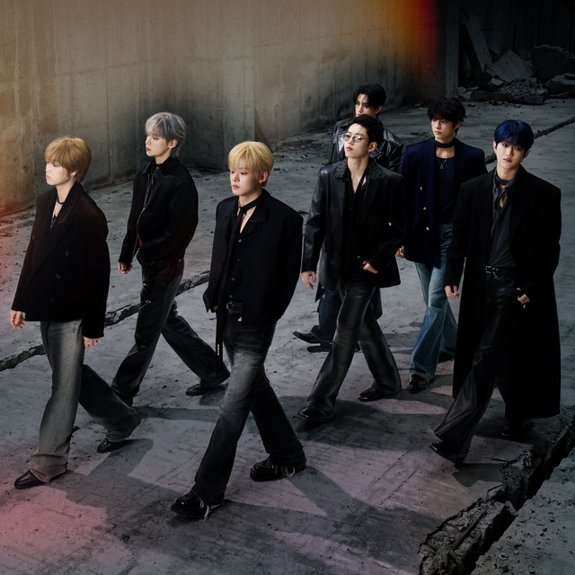

# 인연 : INYUN Part.1

- 아티스트: YOUNITE
- 발매일: 2026-05-12
- 별점: ★★★☆ 3.5
- 기록일: 2026-05-21
- repov 인덱스: 413

---

2.5세대 남자아이돌의 향수를 찾고 있다면 이곳에 들려라.

1. 평행선 3.5
미래지향적인 신스가 오히려 2010년대의 향수를 불러일으킨다. 진짜 스윗튠의 후계자를 찾는다면 닐드를 주목하는 것도 나쁘지 않겠다.

2. POSE! 3.0
이 하우스는 좀 아쉽다. 자신만의 공간을 만들고자 한 노력은 알겠으나, 개인적으로 하우스의 매력은 절제에 있다고 생각해서.

3. Savior 3.5
익숙한 피아노 샘플링에서 각오가 느껴진다. 일렉트릭 기타와 스트링, 트랩 비트가 그 파워를 뒷받침한다. 그런데 그 정도의 명창이 없다. 이 노래는 무대나 콘서트에서 더 진가를 발휘할 것이다.

4. Nothing 4.0
강렬한 기타 리프가 좋다. 그에 비해 드럼은 너무 단조롭다. 좀 더 킥을 쓰는 게 좋았을텐데. 강렬한 반주와 대비되는 섬세한 멜로디라인은 좋은 조화를 이룬다.

5. So Alive 3.5
진부하다고 해도 좋다. 원래 팬송이 그런 장르지. 그래도 최소한 이렇게 무언가를 말하려고 하는 음악이 좋지 않나?
