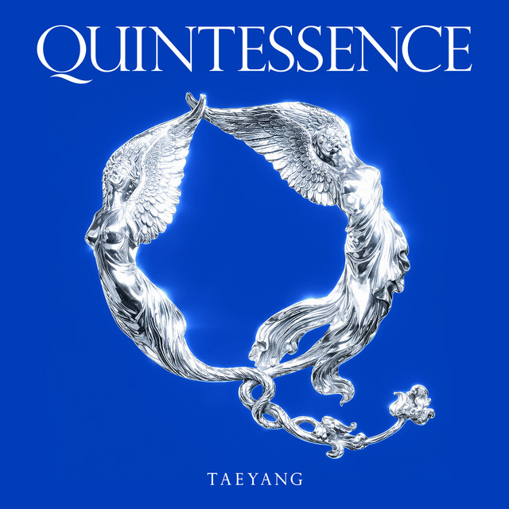

# QUINTESSENCE

- 아티스트: 태양
- 발매일: 2026-05-18
- 별점: ★★★★☆ 4.4
- 기록일: 2026-05-18
- repov 인덱스: 416

---

떠오른 적 없어 진 적이 없으니까

1. BAD 4.0
이 나이를 먹고 이 정도로 요즘 애들 노래를 따라오는게 대단한건지 주책인건지 감이 안 온다. 어쨌든 노래 자체는 명곡이 맞는데, 요즘 애들과 다르게 땡땡하고 정확한 발성이 영 안 맞는다 해야하나? 원래도 뭉개고 넘어가는 타입은 아니었지만 조용필 영향이 크긴 하다.

2. LIVE FAST DIE SLOW 3.0
그래. 빅뱅 그만둘 생각 없는 건 충분히 알겠다.

3. WOULD YOU 4.5
썩은 타잔 치우고 다시 해라 명곡에 이게 무슨 실례냐 영배야

4. MOVIE 5.0 ⭐️
야씨발놈아이걸두고뭘타이틀로한거야이새끼가미쳤나진짜

5. OPEN UP 5.0
왜 키드 라로이를 불렀는지는 알겠는데, 둘의 목소리가 합이 괜찮게 들리진 않는다. 선명한 네온의 세계에서 그저 평범한 EDM으로 흐려지는 느낌이다.

6. LOVE LIKE THIS 5.0
태양의 섹시한 노래를 좋아했던 사람들은 이 트랙이 최애가 될 것이다. 나도 좋아한다. 물론 계절감은 약간 까먹은 거 같지만, 가을에 다시 꺼내 들을 것이다.

7. YES 5.0
이 앨범에서 가장 요즘 노래 같다. 작게 뿅뿅대는 하우스 비트에 시작을 돋우는 신스, 조금 들어간 롤리팝 샘플링까지 세련되었다.

8. NOW 5.0 ⭐️
태양의 애절한 목소리와 직설적인 가사를 듣고 있자니 섹시한 노래를 좋아하는 내 취향이 어디서 왔는지 갑자기 이해가 된다. 이 비트에 맞춰서 도시를 걸을 수도 있고, 미친 듯 춤을 출 수도 있다.

9. G.O.A.T 3.5
나는 이게 꼭 태양이 해야하는 노래라고 생각하진 않는다. 그가 불러서 더 담백하게 들을 수 있는 감은 있지만. 그리고 타블로가 작사하느라 죽도록 고생한 거 같다.

10. 4U 3.5
갑자기 김종완의 영역으로 들어간다. 셔누도 넬 노래 잘 부르던데 이 목소리를 가진 의정부 사람들은 김종완식 감성에 특화된 뭔가 있나?
