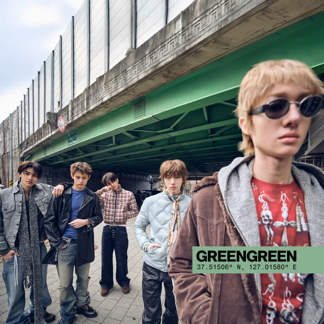

# GREENGREEN

- 아티스트: CORTIS
- 발매일: 2026-05-04
- 별점: ★☆ 1.3
- 기록일: 2026-05-11
- repov 인덱스: 417

---

세계사의 악당을 뽑을 때 무조건 영국을 고르면 맞다는 말이 여기서도 적용될 줄 몰랐다.

1. TNT 1.5
다 똑같은 소리를 악기만 바꿔가며 한다고 해서 신선하다고 생각해줄 거 같은지. 대중이 우습나 싶다.

2. REDRED 1.5
이전 평점 참고

3. ACAI 1.5
생각해보니 내가 아사이볼을 아직 먹어본 적이 없는데, 딱히 먹어보고 싶은 생각이 안 든다. 아는 그 맛이겠지 뭐. 이 노래처럼.

4. YOUNGCREATIVECREW 0.0
이전 평점 참고. 그런데 팬들이 이 앨범 전체에서 이 노래가 제일 좋다고 하는 이유는 알겠다.

5. Wassup 1.0
코르티스의 What You Want을 기억한다. 그랬던 소년들이 이런 감정을 느끼게 되다니 참 슬프다. 그런데 너무 많이 들어봤다.

6. Blue Lips 2.0
비틀즈와 오아시스를 듣는다는게 무슨 뜻인지는 알겠다. 블러는 영크크에 책임이 없지만 비틀즈는 이 노래를 좀 책임져야 하지 않나 싶다.
