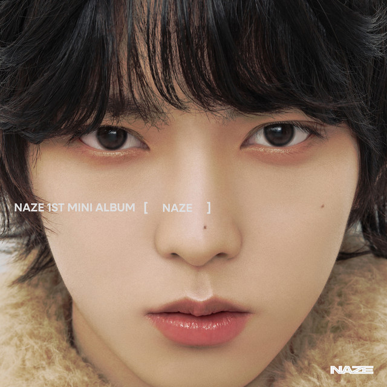

# NAZE

- 아티스트: 네이즈
- 발매일: 2026-05-04
- 별점: ★★★☆ 3.8
- 기록일: 2026-05-11
- repov 인덱스: 418

---

듣기 좋은 노래에는 죄가 없다. 그래서 새로울게 뭔가 고민이 된다는 점은 별로여도.

1. Pretty Pink Socks 4.0
C9엔터테인먼트는 곡을 잘 가지고 오는 소속사다. 내가 이 그룹을 좋아할 마음이 있었다면 불만을 가질 데뷔곡이 아니다. 일렉트로닉 소스화 한 스캣과 경쾌한 피아노로 시작하는 전주가 좋다. 브릿지부터는 어디서 너무 많이 들어봐서 질리는 건 안좋은 점이다.

2. People Talk 3.5
내가 남자아이돌에게 원하는 것이 잘 들어 있다. 섹시함, 패기, 치기, 뭐 그런 것들 말이다. 그런데 전체적으로 브릿지를 좀 덜 뻔하게 만드는 게 좋겠단 생각은 든다.

3. Awesome 3.5
매끈하다. 그러니까 진짜로 이 진부한 브릿지를 어떻게 좀 해라. 끝까지 들어보지 않아도 결판이 나는 음악은 좋은 음악이 아니다.

4. Seoul 4.0
새로우겠다는 포부는 딱히 없고 데뷔를 잘 치뤄내면 다행이겠다는 생각으로 정답지만 쏙쏙 골라 간다.
