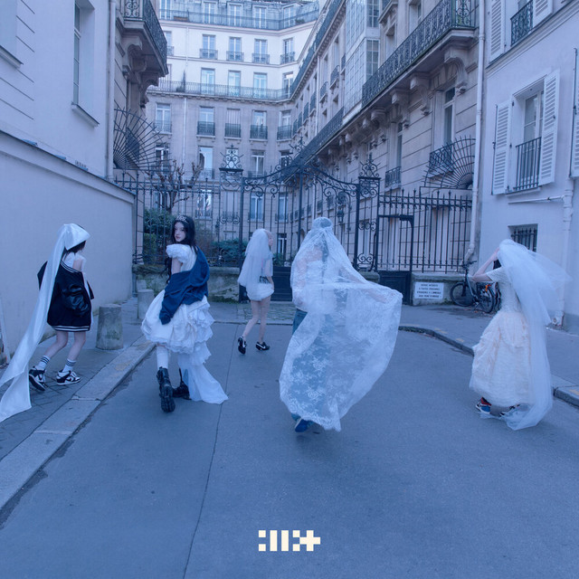

# MAMIHLAPINATAPAI

- 아티스트: ILLIT
- 발매일: 2026-04-30
- 별점: ★★★★ 4.0
- 기록일: 2026-05-11
- repov 인덱스: 419

---

아일릿 음악은 들으면 항상 음악 외의 이유 때문에 마음이 무거워진다. 누군가는 아일릿이 모험을 한다고 하지만, 내가 듣기에 아일릿은 새로운 시도를 하는게 목적인 팀이 아니다. 이 앨범도 근 1년 동안 다른 그룹이 시도한 모든 요소를 가져와서 절대 실패하지 않을 공식으로만 정교하게 쌓아 올린 것이다. 오직 음악적으로만 따졌을 땐 이 정교함과 진부함을 논할 시간도 부족하다.

1. GRWM(Get Ready With Me) 4.0 ⭐️
아무도 해치지 않는 노래는 항상 가볍게 듣기 좋다. 가사는 곡을 이해하지 못한 거 같다.

2. It's Me 4.0
이 노래가 아일릿 답지 않다는 말은 전곡을 듣지 않아서 생기는 오해 같다. 오히려 너무 안전한 부분이 흥미가 떨어진다.

3. paw, paw! 4.0 ⭐️
이 노래가 좋다고 하는 사람들은 다 오타쿠겠지? 당연히 나도 좋다 

4. Mamihlapitapai 4.0
이 노래의 가사가 그렇게 중요한가? 그런 의도를 갖고 만들지도 녹음하지고 않았는데?

5. Love, older you 4.0
이 노래에 위안을 받는 건 잘못되지 않았다. 아무리 생각해도 좀 지나치게 따라했다는 생각을 지울 수 없는게 문제여도.
