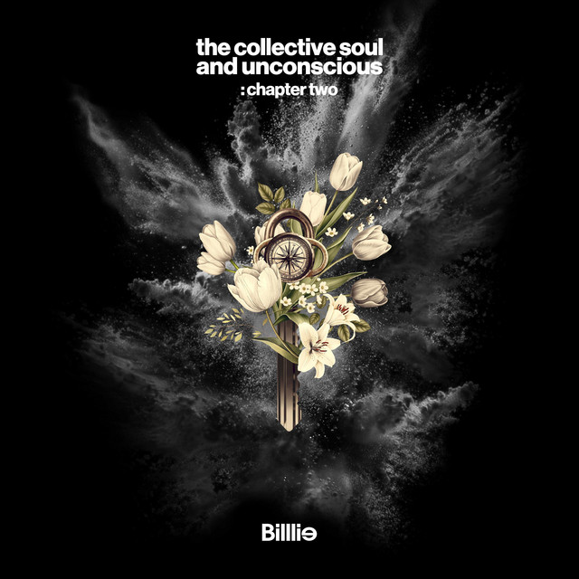

# the collective soul and unconscious: chapter two

- 아티스트: Billlie
- 발매일: 2026-05-06
- 별점: ★★★☆ 3.8
- 기록일: 2026-05-07
- repov 인덱스: 420

---

저희 빌리 잘 되어야 합니다 한 번만 도와주십쇼

1. $ECRET no more 2.0
아무리 그래도 차이코프스키의 백조의 호수는 너무 뻔한 선택이다. 베이스를 덜고 사운드의 질감을 더 가볍게 다듬을 수 있었는데, 여러모로 아쉬운 만듦새다. 스트링과 피아노를 중요하게 기용해준 건 고맙지만, 아직 전주인데 너무 버겁지 않겠나?

2. ZAP 3.5 
처음 내딛는 스텝이 아주 가볍다. 제목이 훅이 아니라 잽인 이유가 있는 것이다. 하지만 그 안의 공격성을 무시하는 순간 크게 다칠 것이다. 빌리에는 문수아가 있으니까. 뮤직비디오는 오히려 방해가 되는 감이 있다.

3. WORK 4.5 ⭐️
이게 올해 들어 대체 몇 만 번째 하우스인지도 모르겠다. 하지만 계속 해도 된다. 이 정도로 할 수 있으면.

4. TBD 3.0
소개와 달리 이 노래 자체가 새로운 지평에 도전하거나 비전을 보여주진 않는다. 최근 3년 사이에 테크 하우스와 하이퍼팝 꼬리를 달고 나온 곡은 다 이런 식이었다. 듣기는 좋다.

5. B'yond me 5.0
허무한 EDM의 범람 속에 있으면 실체 있는 음악이 그리워진다. 살결이 손에 꽉 잡힐 것 같은 노래를 들으니 눈물이 다 나올 지경이다.

6. SOUPASTA 3.0
이것저것 다 합치는 시도는 위험하다. 이도저도 아니게 될 가능성이 있기 때문이다. 레코딩에 훨씬 더 신경을 써야 했다. 이런 노래에선 발음도 발성도 훨씬 더 뒤트는 편이 도움이 된다. 아니면 보코더를 적극적으로 기용하거나.

7. OFF-AIR 2.5
칠아웃과 뉴잭스윙을 이런 식으로 배치해놓고 어울릴 거라 생각한 머저리가 대체 누구일까? 이 노래가 있어야할 공간을 확실히 해라.

8. ZAP (ultraviolet remix) 5.0
H&M 매장이든, 문래동 비스트로든, 어디든 힙이 필요한 장소는 이 노래를 거부하지 못할 것이다.

9. WORK (anonymous remix) 5.0
느끼란 말 정말 싫어하는데 이건 정말 느끼는 것 말고는 방법이 없는 트랙이다.

10. SOUPASTA (unconscious remix) 5.0 ⭐️
내 말이 이 말이다.

11. DOMINO ~ butterfly effect 3.5
상쾌한 유치함이 도미노처럼 우르르 쏟아진다.

12. cloud palace (collective soul remix) 4.0
빌리는 EDM페스티벌 안 나오나?
