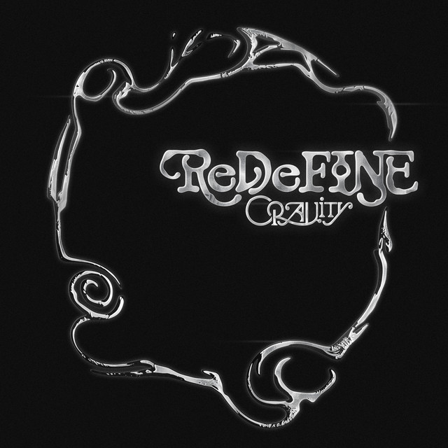

# ReDeFINE

- 아티스트: CRAVITY
- 발매일: 2026-04-29
- 별점: ★★☆ 2.8
- 기록일: 2026-05-06
- repov 인덱스: 422

---

크래비티를 처음 만들 때 이 정도로 살결이 느껴지는 디스코그래피를 예상했더라면 좋았을텐데. 이제와서 보컬을 추가할 수도 없고 이걸 어떡하지?

1. Hello-Goodbye 3.5
스타쉽이 404에 이어 하우스에 일가견이 있다는 것을 증명했다. 사실 실어놓은 비트만 조금 달라질 뿐, 이런 구성은 약 2017년부터 스타쉽의 장기였다.

2. AWAKE 3.0
후렴이 중독적이다. 역시 스타쉽은 섹시한 노래를 가장 잘 셀렉한다. 크래비티에 노래를 제대로 하는 사람이 없다는 사실은 문제가 된다.

3. FEVER 3.0
여기는 이제 더 열심히 하라고 다그치고 싶지도 않다. 이렇게 했는데도 안되는 걸 어떻게 해줄 수가 없다. 노래는 명곡이다.

4. Adore 3.0
진짜 안되는 걸 어떻게 하라는 거지?

5. Love Me Like You Do 1.5
몇 년 사이에 나온 이와 같은 노래를 스무 곡은 더 댈 수 있다. 더 이상은 안된다.

6. 봄날의 우리 3.0
스타쉽은 퓨쳐베이스 장르에 영혼이라도 계약했나? 짬바가 있어서 그런가 적당히 잘 뽑아내는게 웃긴다.
