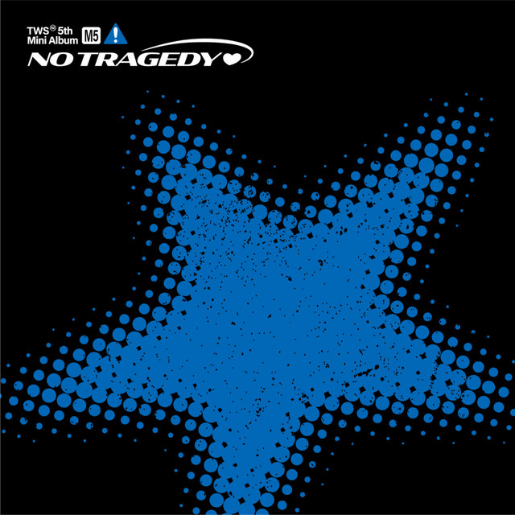

# TWS 5th Mini Album ‘NO TRAGEDY’

- 아티스트: 투어스
- 발매일: 2026-04-27
- 별점: ★★☆ 2.5
- 기록일: 2026-04-29
- repov 인덱스: 425

---

좀 수준 떨어져도 무해한 노래를 타이틀로 고르는게 요즘 전략인가? 나는 그 두려움에 반대한다.

1. 너의 모든 가능성이 되어 줄게 3.5 ⭐️
투어스가 내세우는 보이후드를 해치지 않는 선에서 하우스로 깊이를 부여했다. 스쳐 지나가는 너무 많은 데자뷰는 영원히 해결할 문제다.

2. 널 따라가 2.5
이게 투어스의 보이후드를 해치는 하우스다. 이 맑은 탕도 안 나올 사골 브릿지는 대체 왜 넣은 건지 이해가 안 간다. 노동요로 쓰긴 좋겠다만 진지한 감상의 대상이란 생각이 안 든다.

3. Why You So Bad? 2.5
이 계절에 일렉 신스가 통통 튀는 팝을 굳이 거절할 이유는 없다. 끝까지 들어주기엔 지루하다.

4. Get It Now 3.0 ⭐️
당황스럽다. 투어스에게 기대하는 음악은 이런 게 아니다. 노래 자체는 명곡인데 번짓수를 잘못 찾은 건 아닌가? 여기는 보이넥스트도어가 아니라 투어스다. 혹시 이것이 새로 그리고 있는 지향점인가?

5. Fire Escape 2.0
너무 많은 요소가 싸구려 믹서 속에 돌아가고 있다. 좀 더 융화하려는 시도가 필요하다.

6. Back To Strangers 1.5
이 노래를 2분 33초간 듣느니 이터널 선샤인을 한 번 더 보겠다.
