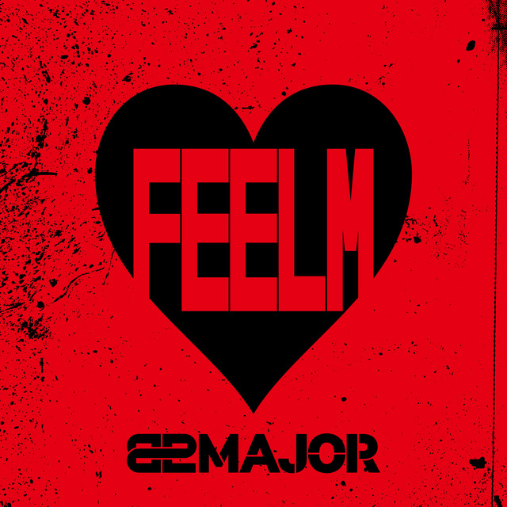

# FEELM

- 아티스트: 82MAJOR
- 발매일: 2026-04-28
- 별점: ★★★☆ 3.6
- 기록일: 2026-04-28
- repov 인덱스: 426

---

너무 많은 트렌드가 쏟아져 어지럽다면 한 발자국 물러서는게 답이다. 그래야 뚝심을 찾을 수 있다.

1. W.T.F 3.5
그 피아노를 여기서 쓰는군. 타블로가 좋아하는 영화적 구성이다. 아직 나레이션을 하기엔 사람이 충분히 깊지 않다는 게 느껴진다. 중간중간 쳐들어오는 코러스는 절묘하지만, 뿌리를 꼭 미국에서 찾아야 했을까?

2. Sign 4.0
기존 82MAJOR의 색에 요즘 유행하는 케이팝의 이지리스닝 문법을 슬쩍 섞었다. 유려하게 흘러가는 건 좋은데, 그대로 흘러가기만 하는 건 문제일지도 모른다. 드러눕기엔 혈기들이 왕성하다.

3. CAGE 3.0
바일레 펑크는 최근에 너무 많이 사용되었다는 느낌이다. 이 노래는 장르에 과하게 잡아먹혔다. 좀 더 거리를 두고 탐구하는 것이 좋겠다.

4. CIRCLES 4.5
말은 드릴이라고 하는데 누가 들어도 그냥 82메이저가 해석하는 밴드사운드다. 웬만큼 밴드한다는 놈들보다는 깡이 있다. 지금 필요한 노래다.

5. YESSIR! 3.0
콘서트용으로는 딱이다. 그 바깥에 존재할 공간이 있어보이진 않는다.
