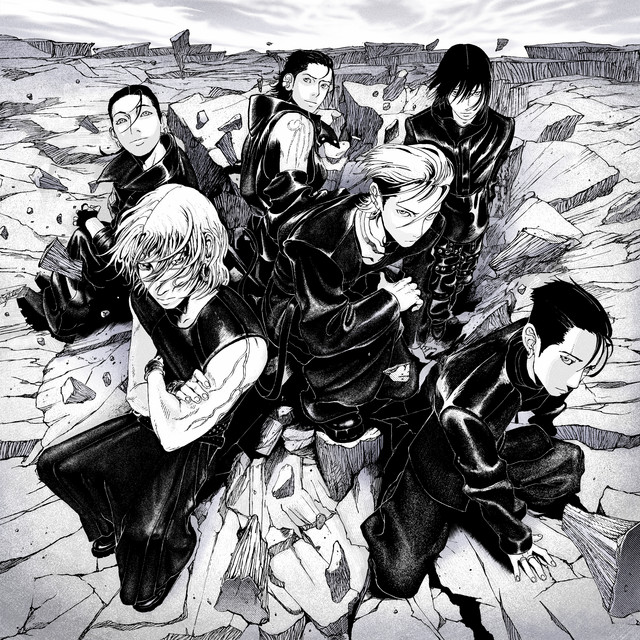

# DEAD AND

- 아티스트: Xdinary Heroes
- 발매일: 2026-04-17
- 별점: ★★★★☆ 4.8
- 기록일: 2026-04-24
- repov 인덱스: 435

---

밴드가 추구해야할 단 하나의 미학은 멋있는 거다. 진흙이 묻어도, 아스팔트 위를 굴러도.

1. Helium Balloon 5.0 ⭐️
전주와 함께 하늘을 봤다. 푸른 하늘 위로 촌스러운 풍선의 심상이 선명히 떠올랐다.

2. Voyager 5.0
엑스디너리 히어로즈는 사운드를 두려워하지 않는 밴드라서 좋다. 진부한 멜로디지만 뻔한 애니 오프닝 송이 아니라서 좋다.

3. No Cool Kids Zone 5.0
엑스디너리 히어로즈 나오는 락페 없나? 이런 노래를 감히 천장 막힌 공연장에서 앉아 있는 관객들과 함께 부를 생각은 아니겠지.

4. Hurt So Good 5.0
오히려 유영진이 생각난다. 그 양반의 평생 숙원이 메탈 잘하는 거였단 걸 기억하면 그다지 틀린 연상도 아니다.

5. Rise High Rise 5.0
메이저 소속사에서 할 수 있는 최대한까지 밀어붙었다. 이 이상으로 나가면 소음이다. 그 선을 정확히 지킬 줄 안다는 게 서운하게 느껴지는건 배부른 소리겠지.

6. KTM 5.0
엑스디너리 히어로즈는 흉내에서 그치지 않는다. 그게 이 밴드가 보여주는 장르에 대한 리스펙이다. 그러니 리스너들도 이들을 진지하게 들어주어야 한다.

7. X room 3.5
진부해서 미칠 것 같은 발라드 트랙이다. 다른 점이 있다면 일단 노래를 잘하고, 음악을 잘한다는 것이다.
