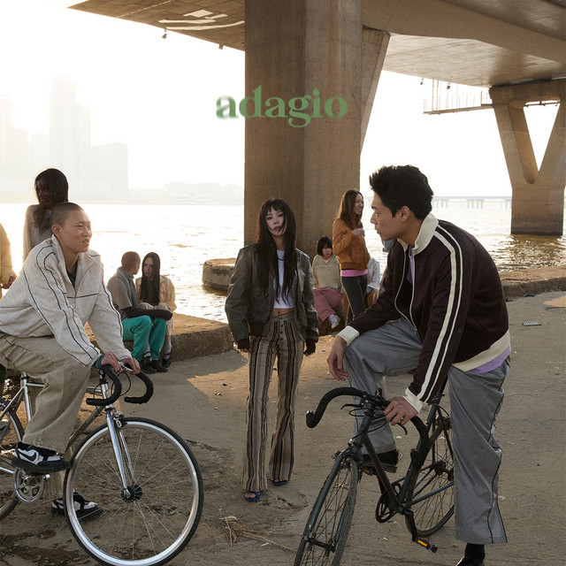

# adagio

- 아티스트: 휘인
- 발매일: 2026-04-16
- 별점: ★★★☆ 3.5
- 기록일: 2026-04-22
- repov 인덱스: 437

---

조금 더 욕심을 부릴 수 있었다. 휘인 정도 되는 가수가 이 정도에 안주하는 것은 너무 안타까운 일이다.

1. The Symphony of Fxxkboys 3.5
휘인은 노래는 정말 잘 하는 사람이다. 그래서 가사를 영어로 선택한 게 참 아쉽다. 벌스는 거의 한국어처럼 들린다. 한국어 가사를 쓰는 작사가들은 이제 다 죽은 건가?

2. Truth Hurts 3.5
갑자기 제니의 Like Jennie가 떠오른다. 이 노래가 그 노래와 비슷한 점은 단 하나도 없고, 재미없는 브릿지를 쓸 거라면 지루하게 하지 말고 그냥 핵심으로 넘어가자는 그 결정이 얼마나 위대한지 새삼 깨닫는다는 뜻이다. 진부한 브릿지가 이 긴장감을 다 망쳐놓는다.
