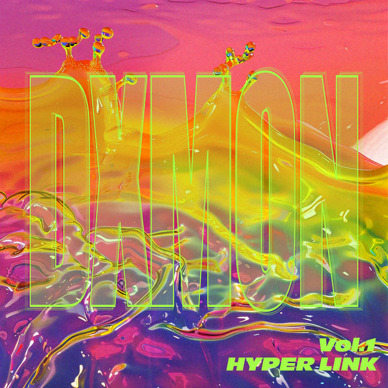

# HYPER LINK: Vol.1

- 아티스트: DXMON
- 발매일: 2026-04-14
- 별점: ★★☆ 2.8
- 기록일: 2026-04-21
- repov 인덱스: 440

---

아직 갈 길이 멀어보인다. 자신들이 가질 수 있는 무기가 무엇인지 깊게 생각해보는 것이 좋겠다.

1. SSS 2.5
라스는 최선을 다했다. 그냥 멤버들이 이 노래를 살릴 역량이 안되는 거다. 아직 나이가 많이 어린가? 유일하게 맛을 살릴 줄 아는 세이타가 서브보컬이라는 점은 좀 놀랍다. 노래는 고음만 된다고 전부가 아닌데 말이다.

2. White Tee 3.0
그냥 적당하다.
