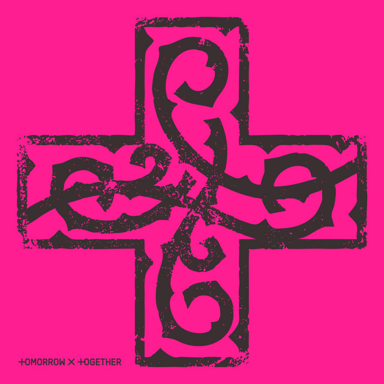

# 7TH YEAR: A Moment of Stillness in the Thorns

- 아티스트: 투모로우바이투게더
- 발매일: 2026-04-13
- 별점: ★★☆ 2.7
- 기록일: 2026-04-20
- repov 인덱스: 443

---

이 그룹은 이쯤 했는데도 여전히 음악적 셀링 포인트를 모르겠다.

1. Bed of Thrones 2.5
투바투에 이 정도 노래를 부를 수 있을 만큼 섹시한 보컬이 있던가? 의문이 들었는데 역시나 없다. 노래가 좋아도 보컬이 못 따라오면 이게 다 무슨 소용인가 싶다.

2. 하루에 하루만 더 3.0
이 모범생들 데리고 할 수 있는 섹시의 끝이란 결국 이 정도구나 싶다. 몇 가지 귀에 띄는 멜로디 진행이 있긴 하지만 어느 순간 DAY6의 Love Me or Leave Me와 겹친다. 그리고 그게 끝이다. 애절하긴 하지만 처절하지 않다.

3. Take Me to Nirvana 3.0
Nirvana의 발음은 정말 "널바나"가 최선이었나? 노래 자체는 적당히 괜찮다. 열반에 오를 정도는 아니지만.

4. So What 3.0 ⭐️
투바투도 모범생이라 불리는데 좀 질리긴 했나보다. 껌을 씹어대진 못해도 꽤 맛을 살린다.

5. 21st Century Romance 2.5
판타지로 시작한 그룹 답다는 생각이 든다. 아직 악상이 특출나거나 충분히 정돈되지는 않았다.

6. 다음의 다음 2.0
설명은 얼터너티브 팝이라고 되어 있지만 이 노래의 문법은 누가 들어도 밴드 사운드에 기반을 두고 있다. 밴드 음악 들어본 사람으로서 후까시 좀 잡자면, 이건 도망친 편곡이다.
