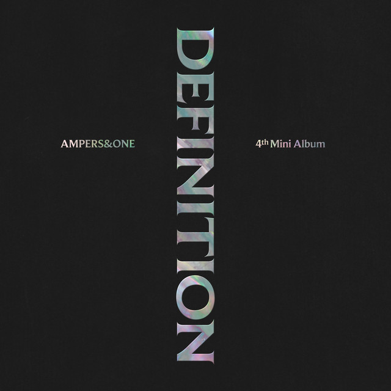

# DEFINITION

- 아티스트: AMPERS&ONE
- 발매일: 2026-04-08
- 별점: ★★☆ 2.4
- 기록일: 2026-04-15
- repov 인덱스: 448

---

그룹의 존재감을 전혀 웅변할 수 없다.

1. Hit Me Up 3.0
확실히 이제 어느 정도 규모가 되는 소속사라면 일정 이상의 퀄리티가 균일하게 나오는 것 같다. (스타쉽 제외) 그러면 결국 차이를 만드는 건 멤버들의 실력인데, 앰퍼선드원은 간신히 출발선에 설 수 있는 수준이다.

2. GOD 2.0
채소 갓도 이것보단 비장하게 부를 수 있겠다.

3. 뭐라는 거야 3.0
서태지가 원래 밴드 출신이라는 걸 누군가는 기억하고 있나보다. FNC는 역시 기타를 잘 쓴다. 메시지가 쉐도우 복싱에 가깝다는 점은 아깝다.

4. 나는 나대로 2.5
이 노래 자체가 뭐 그렇게까지 끔찍하다고 볼 순 없다. 훅은 꽤 비장한 감이 있다. 다만 3번 트랙이 있는데 굳이 있을 필요가 없다. 주제 의식이란 일레트로닉으로 장르만 바꾼다고 해결되는 게 아니다.

5. All Eyes On You 1.5
이쯤해서 달콤한 노래를 하나 넣어야겠다는 그 강박이 진짜 바보 같다. 앨범의 유기성이라는 건 이제 아무도 생각하지 않는 건가?

6. 너의 웃음 속에 눈물이 보여 2.5
피아노는 정말 훌륭한 악기다. 요즘 아이돌 그룹들이 피아노의 위대함을 경시하는게 슬플 만큼.
