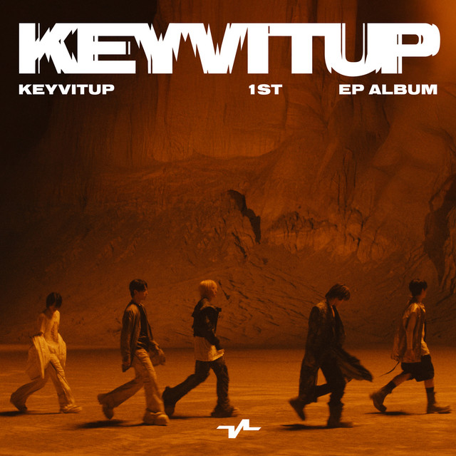

# 1ST EP ALBUM [KEYVITUP]

- 아티스트: KEYVITUP
- 발매일: 2026-04-08
- 별점: ★★★☆ 3.3
- 기록일: 2026-04-14
- repov 인덱스: 450

---

NCT와 SM 사운드 시스템을 전부 집어삼켜서 나온 결과물이다. 점수는 높게 주겠지만, 오리지널리티가 있다고 말해줄 순 없다. 아일릿은 왜 욕먹었나 싶을 정도다. 거기는 뉴진스와 음악적 방향성이 완전 다르거든.

1. BEST ONE 3.5
그동안 참 많은 그룹이 NCT를 따라하고자 했는데, 지금까지는 그게 쉬운 일이 아니라는 걸 증명하는 수준이었다. 그런데 이 그룹은 거의 대체가 가능할 정도다. 장산범이 아닌가 약간 섬뜩해질 정도다.

2. KEYVITUP 4.0
스크래치 소리부터 베이스에서 제대로 올드스쿨이 느껴진다. 이 정도로 레퍼런스에 충실하면서 흉내로 그치지 않는다는게 공포스럽다.

3. LEGENDARY 4.0
소속사가 대체 어디길래 이 정도의 퀄리티가 나오는지 이해가 안 된다. 크게 새로운 음악은 아닌데, 드럼부터 베이스, 스트링과 키보드까지 모든 요소에서 돈이 느껴진다. 브릿지는 완벽하게 SM 스타일이라서 좀 식상하게 느껴지는게 흠이라면 흠.

4. SHOW ME SOMETHING 3.5
올드스쿨로 일관하며 고수하는 스크래치 소리가 마음에 든다.

5. POLAROID 1.5
이런 식으로 그냥 없으면 섭섭해서 끼워넣는 발라드 팬송 트랙은 이제 존재 이유를 거부하겠다.
