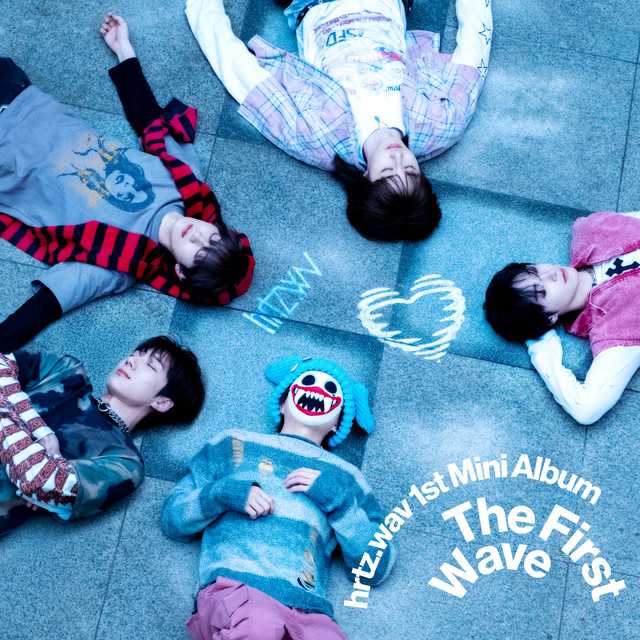

# The First Wave

- 아티스트: hrtz.wav
- 발매일: 2026-04-08
- 별점: ★★☆ 2.7
- 기록일: 2026-04-09
- repov 인덱스: 452

---

보컬 데리고 폭포 가서 득음하고 와라.

1. Dream 1.5
그 무수한 청량밴드곡 사이에 이 노래가 존재해야하는 이유가 무엇인가?

2. NINETEEN 2.0
밴드한다는 사람이 이렇게 힘이 없어도 되나? 난 잘 모르겠는데.

3. Highlight 3.0
보컬에게 한 가지 말해주고 싶은데, 본인의 재능은 발라드다.

4. I AM SO FINE 2.5
이제야 좀 파이팅이 올라오는군. 역시 밴드는 원래 좀 구질구질 해야 맛이 산다.

5. 어리버리 4.0 ⭐️
일단 어리버리라는 말의 맛이 좋다. 나는 이걸 타이틀로 하는게 좋았을 거 같단 생각을 한다. 처음은 원래 설레기보단 좀 무섭지.

6. 우리만의 이야기 3.0
앨범 마지막 트랙을 밴드사운드의 팬송으로 채우는 거 이제 법으로 금지할 때가 됐다. 그게 밴드라도 말이다.
