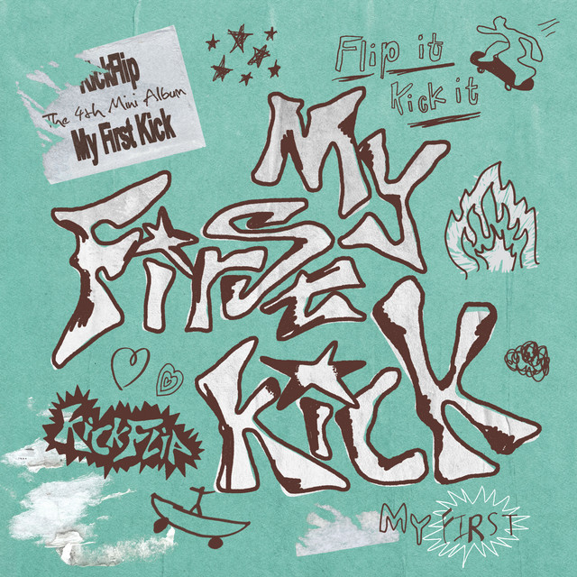

# My First Kick

- 아티스트: KickFlip
- 발매일: 2026-04-06
- 별점: ★★★☆ 3.1
- 기록일: 2026-04-07
- repov 인덱스: 455

---

더 압축할 수 있을 정도로 성기다. 필요 없는 노래는 쳐내는 용기가 필요하다.

1. 눈에 거슬리고 싶어 4.0 ⭐️
세븐틴의 후계자는 킥플립이 되려는가?

2. Twenty 3.0
괜찮은 노래다. 하지만 새로운 사운드를 제시하진 않고, 끝까지 예측가능하다.

3. Stup!d 3.0
저런. 에이브릴 라빈의 자리는 그렇게 아무나 가져갈 수 있는게 아니다. 진정성이 없다. 제목에 i대신 !를 썼으면 당연히 이런 식으로 흘러가겠거니 예상이 된다.

4. 거꾸로 4.5 ⭐️
의도와 태도와 완성도가 퍼즐처럼 맞물린다. 아마 킥플립 멤버들이 하고 싶었던 음악은 이쪽에 더 가까울 거 같다. 영ㅋㅋ가 이 정도만 됐어도 코르티스가 수월히 5세대의 왕관을 차지했을텐데 말이다.

5. Scroll 1.5
이 노래까지는 필요 없다.

6. Roar 3.0
노래는 적당히 하드코어한데 아직 목소리들이 충분히 여물지 않았다. 보이넥스트도어보단 한참 낫고, 스트레이키즈에 살짝 못 미친다.

7. My Direction 3.0
내가 모르는 사이에 아이돌 앨범에 반드시 팬송이 들어가야 한다는 법이라도 생겼나?
