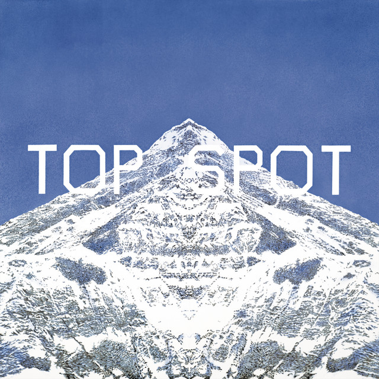

# TOP SPOT - 다중관점 (ANOTHER DIMENSION)

- 아티스트: T.O.P
- 발매일: 2026-04-03
- 별점:  NaN
- 기록일: 2026-04-06
- repov 인덱스: 457

---

이 앨범에 점수를 매기고 평가를 하는게 무슨 의미가 있겠는가. 한 인간의 뇌를 푹 떠내서 그대로 트랙에 짓이기듯 쳐바른 것을?

그냥 이런 생각 하나만 정립된다. 빅뱅 멤버들을 한 단어로 표현하자면, 지드래곤은 스타, 태양은 뮤지션, 대성은 딴따라, 그리고 탑은 아티스트.
