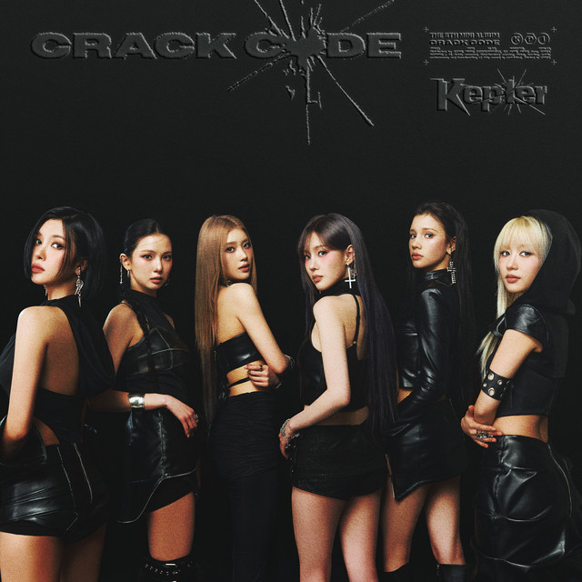

# CRACK CODE

- 아티스트: Kep1er
- 발매일: 2026-03-31
- 별점: ★★☆ 2.9
- 기록일: 2026-04-01
- repov 인덱스: 461

---

따라해서 이 정도면 이 사람들이 새로 해낸 건 없단 뜻이다.

1. I am Kep1 3.0
충분히 좋은 음악이지만 아직 틀을 깨지 못했다.

2. KILLA (Face the other me) 3.5
간신히 바운더리에서 오락가락 한다. 하지만 덮어두고 좋다고 하기엔 머릿속을 스쳐지나가는 노래가 너무 많다.

3. MIC CHECK 3.0
매끈하게 잘 따라했다. 케플러만의 진정성은 느껴지지 않는다.

4. 있지... 2.5
대놓고 레드벨벳과 에스파의 수록곡을 레퍼런스로 삼았다. 그런 것치곤 곡에 대한 이해가 없다. 심지어 제목도 촌스럽군.

5. Addicted 2 Ya 2.5
신화를 레퍼런스 삼기로 한 건 잘한 결정인데, 그럼 끝까지 밀어붙였어야 한다. 첫번째 후렴부터 그 뒤로는 어떤 도전도 없다.
