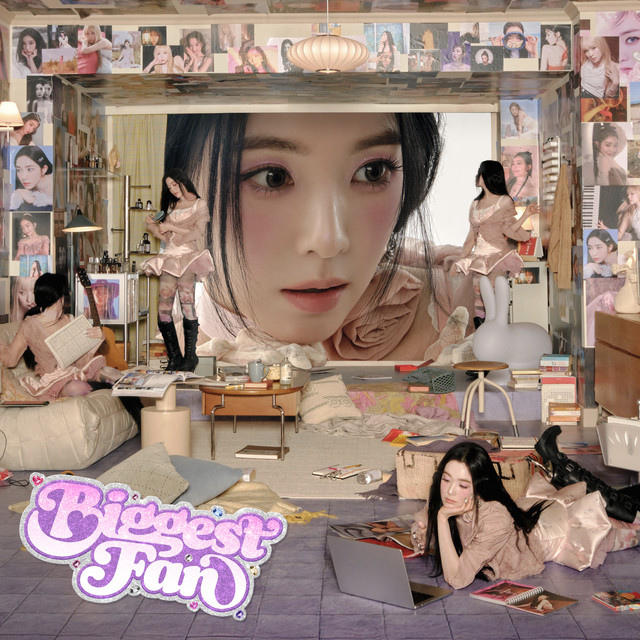

# Biggest Fan - The 1st Album

- 아티스트: 아이린
- 발매일: 2026-03-30
- 별점: ★★★ 3.0
- 기록일: 2026-04-01
- repov 인덱스: 463

---

솔로를 자신이 원해서 하는 사람들이 있고, 팬들을 위해서 하는 사람들이 있다. 전자를 아티스트라고 하고 후자를 아이돌이라고 한다. 아이린은 후자다. 나는 아이린이 아티스트가 되길 바란다.

1. Biggest Fan 2.0
메시지도 사운드도 뭐 하나 지루하지 않은 구석이 없다. 화자가 아이린이라 황송할 뿐이지.

2. Best Believe 3.0 ⭐️
팬들이 좋아해서 수록했다는 말을 봤다. 아이린 팬은 대부분 레드벨벳에 충성한다는 걸 알 수 있다. 나도 그렇기 때문에, 노래만은 명곡이 맞다.

3. Don't Wanna Get Up 4.0 ⭐️
멋진 하우스 장르다. 나라면 이 노래를 타이틀로 했다. 진심으로 하는 말이다. 우리가 아이린에게 바라는 건 Sunkiss가 아니다. 우리는 그저 아이린의 황홀함으로부터 깨어나고 싶지 않다.

4. Face To Face 2.5
인피니트가 했을 법한 노래다. 아이린에겐 지나치게 무겁다.

5. Million Miles Away 3.0 ⭐️
이 정도의 무게가 딱 좋다. 아이린의 보컬에는 우주를 전개하는 힘이 없다. 그랬다고 무중력 공간을 우아하게 유영하는 우주먼지에 아무 가치가 없는 건 아니잖은가.

6. Love Can Make A Way 2.0
아이린의 앨범에 있어야 할 노래가 아니다. 웬디를 불러와라. (웬디 최애곡이 이거란 말을 봤다. 방정식처럼 당연한 일이다.)

7. SPIT IT OUT 3.0
어울리는 공격성이다. 대구의 토양이 그를 이렇게 키운 건지는 모르겠지만.

8. Black Halo 3.0
레드벨벳의 벨벳 컨셉을 좋아했다면 이 노래를 좋아할 것이다. Rainbow Halo의 잔혹동화 버전이다.

9. MTV (My Timeless Video) 4.0 ⭐️
이런 노래를 틀어놓고 한강 공원이라도 덩실덩실 거닐고 싶다. 마침 봄이니 말이야.

10. Wasteland 3.5 ⭐️
모든 것이 환상처럼 떠 있다. 가끔 아이린의 목소리가 현실처럼 와닿는다. 잔뜩 취한 80년대의 파티장과 뿌리 깊은 현실을 잇는 웜홀 같은 노래다.
