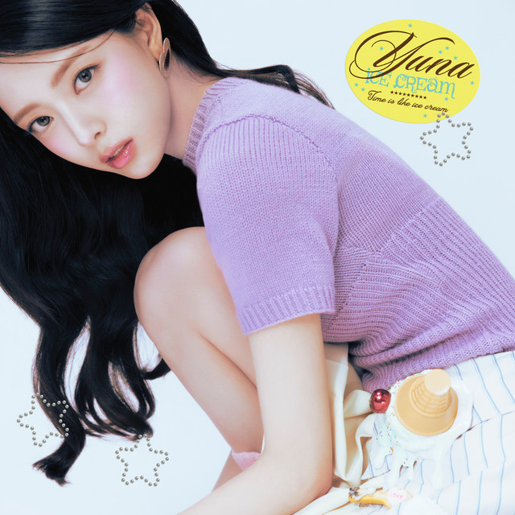

# Ice Cream

- 아티스트: YUNA
- 발매일: 2026-03-23
- 별점: ★★★☆ 3.8
- 기록일: 2026-03-28
- repov 인덱스: 476

---

유나는 가수보단 디렉터로서의 재능이 훨씬 더 뛰어나보인다.

1. Ice Cream 3.5
버블검 팝은 지금 진지하게 들어둬야 하는 장르가 맞다. 유나가 2003년생의 막내라는 점을 생각하면 정확한 선택이다. 하지만 유나의 보컬 실력은 전혀 진지하지 않다. 작사가진에서 엑시의 반가운 이름이 보인다.

2. B-Boy 3.5
이 노래는 정말 좋은 노래다. 진지하게 이번 달에 들었던 모든 브레이크비트 중에 제일 좋다. 다만 유나가 이 노래를 감당할 수 있는 보컬이 아니다.

3. Blue Maze 4.0
곡 퀄리티만 두고 보면 이 앨범이 있지 정규 앨범 Tunnel Vision 보다 낫다. 유나가 약간 아이브의 가을과인가 보다. 무슨 뜻이냐면 안목이 굉장히 뛰어나고, 무대 구성력이 훌륭하며, 보컬의 한계가 너무 뚜렷하단 뜻이다.

4. Hyper Dream 4.0
정말 어디서 이런 곡들을 셀렉해서 갖고 온 거지? 요즘 이런 노래를 노리는 그룹이 한둘이 아닐텐데. 가사의 맛은 좀 더 생각해보는 편이 좋겠다. 다른 건 다 괜찮은데 후렴 가사가 아무래도 좀 후지다.
