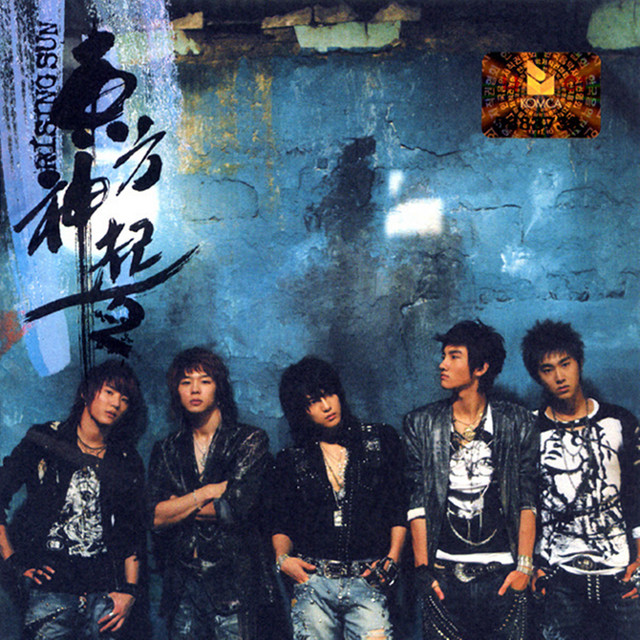

# Rising Sun - 2nd Album

- 아티스트: 동방신기
- 발매일: 2005-09-12
- 별점: ★★★☆ 3.4
- 기록일: 2026-03-27
- repov 인덱스: 479

---

하루 정도 가둬놓고 발등에 불 떨어진 듯 녹음을 한 건지 트랙 하나 지날 때마다 레코딩 퀄리티 차이가 아주 난장판이다.

1. Tonight 4.5
솔직히 너무 어려운 곡이다. 동방신기마저도 이 노래가 가진 포텐셜을 전부 끌어내지 못했다. 그러니까 한 70% 정도? 그렇지만 이 노래를 동방신기가 아닌 다른 그룹이 하면 0.7%도 기적일 거다.

2. Beautiful Life 3.5
시아준수도 있고 영웅재중도 있는데 굳이 최강창민에게까지 알앤비를 시켜야 했을까? 거의 토할라 그러는데.

3. Rising Sun(순수) 5.0
냉정하게 평가하려면 할 수야 있겠지. 그런데 그럴 거면 케이팝을 왜 듣나.

4. 바보 (Unforgettable) 4.0
이 당시 가수 중에 저 놈의 물방울 안 떨어뜨려 본 사람이 존재는 할까 싶다. 1집 때보다 훨씬 세련되게 연마한 화음이 고막을 반겨준다.

5. 내가 허락할 테니 (Love Is Never Gone) 2.5
1절이 통째로 반음 떠 있다. 뒤가 좀 부담된다면 저음 연습을 열심히 하는 편이 좋았을 테다. 그래도 Jack Kugell이 SM에 준 노래 중에는 그나마 양심 있는 난이도다.

6. Love After Love 2.0
솔직히 이 노래는 너무 대놓고 그 당시 팝송을 베껴온데다 화음 파트가 통째로 불협이라 좋은 점수를 주기 힘들다.

7. Dangerous Mind 1.5
왜 이렇게 자꾸 음이 위로 뜨는지 알 수가 없다. 게다가 대놓고 마이클 잭슨 파쿠리다. 물론 그건 라이징썬도 마찬가지긴 한데, 이건 유영진의 흑역사라고 해도 좋은 노래다.

8. One 3.0
드디어 켄지가 구원투수로 등장했다. 발라드에서도 급격히 변화하는 음역대의 사용으로 뒤집어지는 목소리를 사랑하는 그 쪼는 어디 안 간다.

9. Love Is... 4.0
클래지콰이의 클래지가 동방신기에게 노래를 주던 시절이 있단 걸 아는 사람? 개인적으로 이 노래에 쓰인 소스가 진짜 2000년대 음악을 정의한다고 생각한다.

10. Free Your Mind 3.0
세상에 불만 많은 사람들은 결국 바이올린을 찾게 되어있나보다. 비발디가 그래서 락했잖아.

11. 작은 고백 (Love Is All I Need) 3.5
발라드는 웬만해서 망치기 쉽지 않지만 잘 만드는 건 훨씬 어렵다. 이 정도면 균형을 잘 맞춘 편이다.

12. 약속했던 그때에 (Always There...) 4.5
동방신기가 요즘 노래 잘 한다고 하는 아이돌 그룹과 근본적으로 다른 점이 뭐냐고 물어보면, 이 노래를 들려주면 된다. 장르가 아니라 클래스의 차이다.
