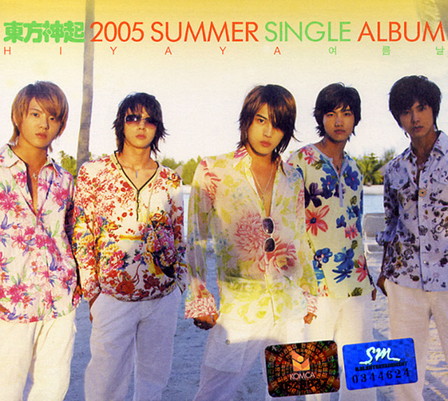

# Hi Ya Ya 여름날

- 아티스트: 동방신기
- 발매일: 2005-06-20
- 별점: ★★★☆ 3.5
- 기록일: 2026-03-27
- repov 인덱스: 480

---

아무래도 여름이라는 계절을 잘못 알고 있는 게 분명하다.

1. Hi Ya Ya 여름날 3.5
이 노래를 들을 때마다 당황스러운 점이 뭐냐면, 이거 캐롤이잖아. 대체 어쩌다가 이 노래가 여름 노래로 낙점당한 건지 정말 알 수가 없다.

2. 공간 (하늘과 바다 사이... - Whisper of...) -
지금의 동방신기를 잡아서 묶어두고 들려주면 재밌는 소리 날 듯

3. 너희들 것이니까 (I wish...) 3.5
이 노래는 한 5키 정도 높여야 한다. 윤상이 걸그룹 노래를 잘 만드는 데는 이유가 있는 거다. 여전히 가사는 무슨 뜻인지 모르겠습니다, 박창학씨.
