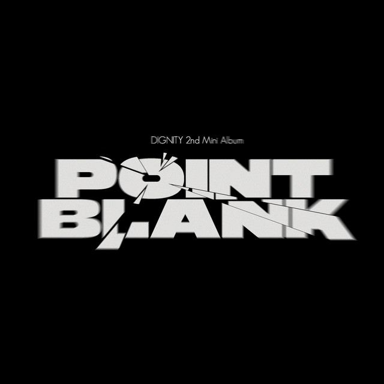

# POINT BLANK

- 아티스트: DIGNITY
- 발매일: 2026-03-26
- 별점: ★★☆ 2.8
- 기록일: 2026-03-27
- repov 인덱스: 483

---

짙은 잔향을 남기려면 충격도 그만큼 세야 한다.

1. INTRO -
적당한 긴장감이 몸을 조인다. 

2. Go Crazy 2.5
질주하는 트랙 위로 멤버들이 한발짝 늦게 발을 떼는 모양새다. 속도를 내려면 지면을 더 깊이 밟아야 한다.

3. SLIPSHOT 3.0
나름 날렵한 기지를 보여준다. 그래도 아직 골리앗의 머리를 노리기엔 힘이 부족하다.

4. Is This Love? 3.0
들을 만한 노래이긴 한데, 위에서 제대로 된 샷을 날리지 못하니 이 노래로 넘어가는 흐름도 그저 그렇게 느껴진다.

5. Ask You 2.5
뒤에 깔리는 관악기 소리가 의외로 신선하다. 이 그룹은 이런 컨셉을 더 잘하는 것 같으니, 어울리지도 않는 힙합은 내려놓는게 어떤가?
