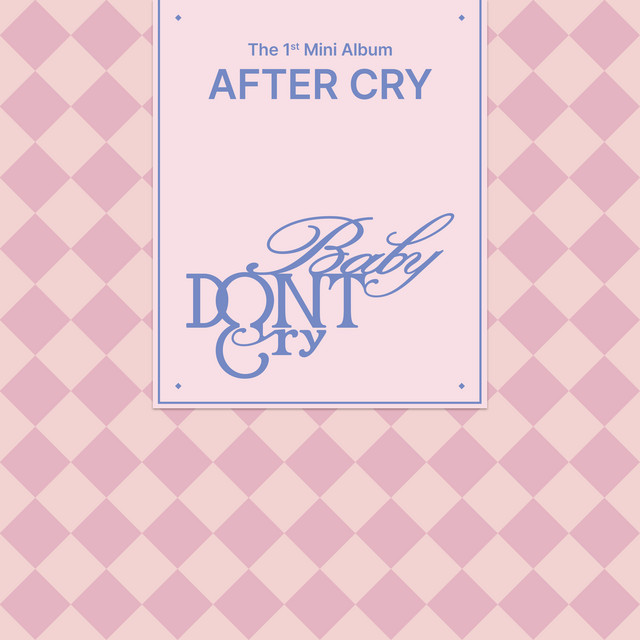

# The 1st Mini Album [AFTER CRY]

- 아티스트: Baby DONT Cry
- 발매일: 2026-03-24
- 별점: ★★★☆ 3.4
- 기록일: 2026-03-26
- repov 인덱스: 486

---

앨범을 만들기 전에 멤버들과 좀 더 이야기를 나누어 보는 것이 좋았을 테다.

1. Mama I'm Alright 3.0
의도를 이해할 수 없는 샘플링은 항상 당혹감을 불러 일으키는 것 같다. Dragostea Din Tei여야만 했던 이유를 좀 더 설명받고 싶다.

2. Bittersweet 3.5
피네이션은 JYP보다 훨씬 직관적이다. 음악의 퀄리티에서는 전혀 타협하지 않으면서, 절대 대중을 거스르지 않는 선택을 한다. "나는 이 게임의 엔딩을 기억하거든"은 강력한 가사지만, 바운더리를 넘어서는 충격을 주는지는 잘 모르겠다. 기현의 Youth가 생각나는 건 김이나와 라이언전이 참여해선가?

3. Shapeshifter 3.5
베이비돈크라이 버전의 스물셋이라고 할까. 어른과 소녀의 경계에서 노래한다는 건 어려운 일이다. 그 중용을 지키는데 성공하지 못했다. 아직은 더 어리기 때문이겠지.

4. Moves Like Ciara 4.0
의외로 기리보이가 그룹의 색을 잘 이해하고 있는 듯 하다. 그 나이대 아이들의 당돌함과 싸가지를 잘 담아냈다.

5. Tears On My Pillow 3.0
피아노를 좀 더 잘 사용할 수 있었던 노래다. 멤버들이 이 멜로디와 공명한다는 느낌이 전혀 들지 않는다.
