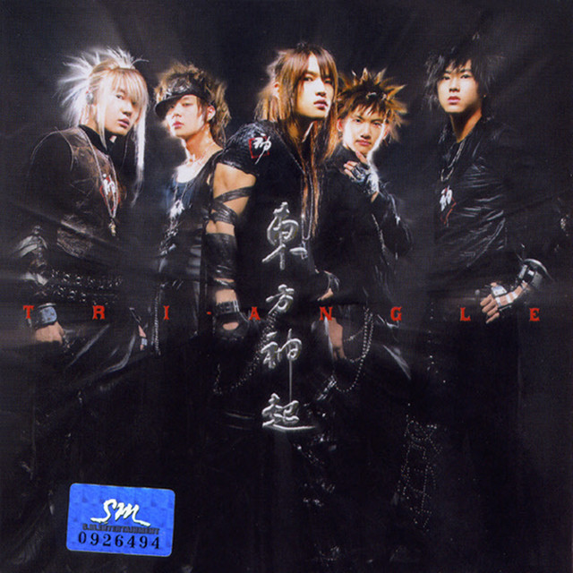

# Tri-Angle - The 1st Album

- 아티스트: 동방신기
- 발매일: 2004-10-01
- 별점: ★★★☆ 3.3
- 기록일: 2026-03-24
- repov 인덱스: 488

---

아카펠라 그룹이 무슨 뜻인지 알고 싶으면 이 앨범을 들으면 된다.

1. 믿어요 5.0
이 때는 동방신기도 "걸..." 이지랄 했구나. 솔리드의 굳건한 영향력이 느껴진다. 그런데 왜 요즘은 이렇게 알앤비의 맥이 끊겼을까. 물론 이 노래는 완전 발라드로 불렀다. 이 당시 시아준수는 아직 시아준수가 아니었다. 0.7시아준수 정도?

2. Thanks to 3.5
원초적인 새소리가 중간중간 사람을 웃긴다. 못 만든 노래가 아닌데 거기서 자꾸 집중력이 흐려진다. 이 당시엔 이상하다고 생각 안했던 거 같은데. 10대 어린이들 데리고 이런 노래를 하면서도 어버이날 노래처럼 들리지 않을 수 있다 자신한 건 아무래도 영웅재중 덕분이겠지. 최강창민은 효도할 거다.

3. TRI-ANGLE 5.0
이 노래의 존재 이유는 보아다. 지금 듣고 있으려니 성녀 파트가 원래 어떤 의미였는지 역사교육이라도 받는 기분이다. 최강창민은 아직도 메탈할 생각 없는지 묻고 싶다.

4. 내 여자친구가 되어줄래? 3.5
팬송은 이 때도 좀 CCM같았나보다. 그 당시로 돌아가서 이 노래를 듣는다고 생각해봤다. 내가 반지를 받고 싶은 사람은 의외로 최강창민이다. 그야 나는 이 때 미성년자였는걸. 티파니 까르띠에가 아니라 못된고양이 정도가 적당하다.

5. Whatever They Say 4.0
동방신기가 원래 아카펠라 그룹으로 나왔다는 거 기억하는 사람? 동방신기 좋아했던 사람들이 쉽게 다른 그룹으로 못 갈아타는 거 이해한다. 가창의 레벨이 다르다.

6. Million Men 3.0
그래, 사실 이 노래가 Dirty Cash보다 먼저였다. 이게 지금 와서 SM을 보니까 웃긴 거지 실제로 웃긴 노래는 아니라고 생각한다. 이 때처럼 가수들이 사회에 관해 말하던 시절이 그립기도 하다. 무슨 생각으로 10대 청소년들에게 이걸 부르라고 한 건지는 모르겠다만.

7. 지금처럼 2.5
위의 노래와 마찬가지로, 그다지 물 흐르듯 전개된다는 느낌은 아니다. 몇몇 코러스는 좀 과하다 싶다. 그나저나 슬슬 이쯤되면 동방신기 중에 누가 이 노래들을 기억하고 있을지 궁금해지긴 한다.

8. I Never Let Go 3.0
모르는 목소리가 있는데? 설마 저거 믹키유천이야? 딱 한 곡 제외하고 발라드 내지 알앤비를 주구장창 듣고 있자니 속이 상당히 부대낀다. 내가 이런 노래 듣고 싶었으면 플라이투더스카이 좋아했겠지...

9. 꼬마야 3.0
이게 연말 앨범이었나? 잘 기억이 안 나는데. 아마 지금 이 노래를 다시 만들라고 하면 더 매끄럽게 만들 수 있을 거다. 그야 이건 아마도 SM the Ballard의 프로토타입이니까.

10. 넌 언제나 2.0
이상하게 좀 흉내낸다는 느낌이 있다. 뭐하자는 짬뽕이었을까 이건.

11. Hug(포옹) 5.0
1세대부터 지금까지, 가장 센세이셔널한 아이돌 데뷔곡은 단연 Hug의 몫이다. 이 자리는 H.O.T.의 전사의 후예에도, 뉴진스의 Attention에도 양보할 수 없다. 커리어 전체로 봤을 때 동방신기보다 더 성공한 아이돌은 많다. 그런데 동방신기보다 더 성공적으로 "데뷔"한 아이돌? 단언할 수 있다. 그런 건 없다.

12. My Little Princess 3.0
내가 어렸을 때 동방신기 노래를 잘 안 들어서 T가 됐나...

13. The Way U Are 4.0
사실 이 노래 자체는 대략 3점대라고 생각하는데, "싫다고는 하지마"로 시작되는 브릿지가 너무 좋아서 4점을 준다.
