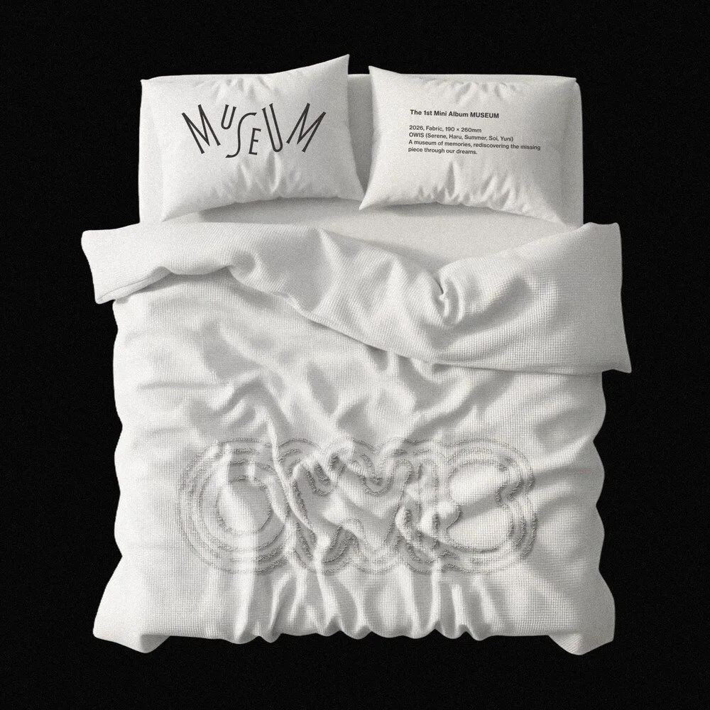

# MUSEUM

- 아티스트: OWIS
- 수록: 2026
- 별점: ★★★☆ 3.7
- 기록일: 2026-03-24
- repov 인덱스: 489

---

이해인은 케이팝이 질리지도 않을까? 이 앨범은 그 질문의 답이다. 사람이 아니라 음악을 좋아하니 질릴 일이 없다.

1. MUSEUM 3.5
적당히 환기가 된다. 지금이 딱 창문을 열 때다.

2. airplane : 143 4.0
8비트의 꿈을 꾸는 종이비행기가 조용히 항해한다. 추락할 걱정은 없다. 여기는 판타지 속이니까.

3. juicy 4.0
기타와 함께 땅바닥에서 1cm 정도 떠오를 수 있을 것 같은 기분이다. 가벼운 브라스의 터치가 흥을 돋운다.

4. missing piece 4.0
잃어버린 퍼즐 조각과 꿈만 같은 이상형의 공통점. 자꾸 신경쓰이고 심장을 조금 빠르게 뛰게해 렘수면 같은 불면을 유도한다는 점.

5. lonely lullaby 3.5
전형적인 케이팝의 구성이지만 악기의 선택이 전형적이지 않다. 그 섬세함이 기분 좋은 위트로 다가온다.

6. ONLY WHEN I SLEEP 4.0
꿈에서만 연주할 수 있는 아프로비트 같다. 발음에는 좀 더 유의했으면 좋았을 것.

7. forNEVER 3.0
노래 자체는 만점인 알앤비. 이 장르가 워낙 어렵기도 하고, 오위스에 좋은 알토가 없다는 사실은 계속 발목을 잡을 것이다.
