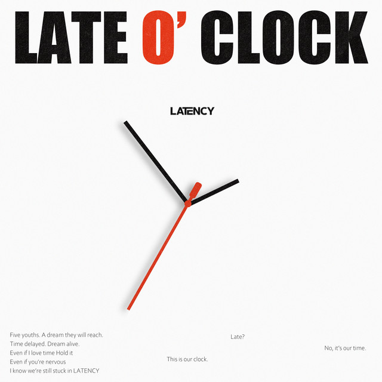

# LATE O' CLOCK

- 아티스트: LATENCY
- 발매일: 2026-03-18
- 별점: ★★★☆ 3.2
- 기록일: 2026-03-23
- repov 인덱스: 491

---

EUGENE(HIGHBIRD)이 곡을 잘 만드는 건 맞지만, 이 그룹에 맞는 색은 아니다. 스윗튠 아직 살아있던가?

1. SAY LOVE 4.0
이 노래를 들으며 어디라도 걷고 싶냐고? 물론이지.

2. LATENCY 3.0
그러게. 너무 늦게 도착했다.

3. MALIBU 3.0
내가 말리부를 가보진 않았지만 이보다 그런지하다는 건 안다.

4. 사랑이었는데 3.0
더 낮은 목소리의 보컬이 필요했다. EUGENE과 이도훈이 노래를 잘 만드는 건 알겠는데, 이 팀에 맞는 노래를 만들어주지는 못한다.

5. STARRY NIGHT 3.0
이 그룹이 이 노래를 부르는 것에 대체 어떤 의미가 있나? 여전히 알토는 부재중이다.
