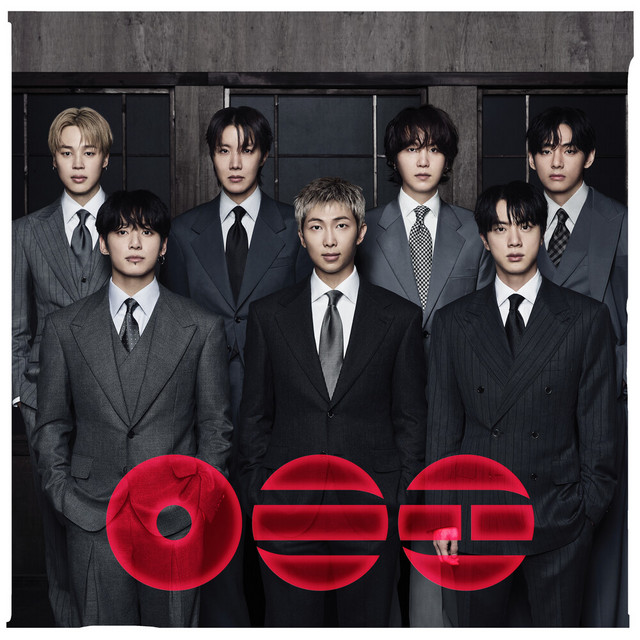

# ARIRANG

- 아티스트: 방탄소년단
- 발매일: 2026-03-20
- 별점: ★★☆ 2.8
- 기록일: 2026-03-20
- repov 인덱스: 495

---

절반 이상 필요 없는 노래이며, 이건 아리랑이 아니다.

1. Body to Body 2.5
뒤에 아리랑이 붙는 아웃트로 말고는 딱히 기억에 남지 않는다. 의도를 붙들지 않는다는 점에서는 빵점이다.

2. Hooligan 2.5
비트는 슈프림팀이 아메바컬쳐에 있을 때가 생각날 정도로 클래식하게 좋다. 그런데 이 노래가 가야 하는 방향을 이해하지 못한 것 같다. 이 뜬금없이 들척지근한 멜로디 누가 집어넣자고 했는지 모르겠지만 나가서 손들고 반성 좀 해라.

3. Aliens 2.0
국적이 없다는 점에서 에일리언은 맞다. 나쁜 의미로.

4. FYA 1.5
어떤 구절도 이 노래가 이 세상에 존재하는 이유를 설득하지 못한다.

5. 2.0 1.0
방탄에 이제 20대 없지 않나? 코르티스는 어리기라도 하지 나이 먹고 이게 무슨 추태인가.

6. No.29 -
예술병은 적당히 와야 한다.

7. SWIM 1.5
광화문 콘서트 취소하기엔 많이 늦었나?

8. Merry Go Round 3.0
좋은 노래인데, 다들 제대로 무기력하기엔 돈을 너무 많이 버셨나보다. 아니면 제대한 게 그만큼 기쁘거나.

9. NORMAL 3.5
꼭 영어를 하지 않았어도 되는 멤버가 4명 정도 된다.

10. Like Animals 4.0
이건 또 제대로 했네. 우울의 유사에 파묻혀 함께 춤추자니, 과연 "방탄"소년단다운 프로포즈다.

11. they don't know about us 4.5
방시혁이 의도한 건지는 모르겠지만, 이 나이와 명성을 얻고도 너희는 날 모른다며 징징거리는 노래를 이렇게 잘할 수 있는 이들은 진정 "소년단"이 맞다.

12. One More Night 3.5
나는 애시드 하우스를 별로 안좋아한다. 남자가 나약한 소리하는 것도 딱 질색이다. 그래도 이건 잘 만든 노래가 맞다.

13. Please 3.0
팬송에 808베이스 쓰자는 아이디어는 어떤 놈이 낸 건가? 그 놈만 나가라.

14. Into the Sun 3.5
어째 제목이 아리랑인 앨범인데 도착지는 자메이카와 카리브 해에 인천 펜타포트 갯벌을 묘하게 섞어놓은 노래네. 님이 참 멀리도 가셨다.
