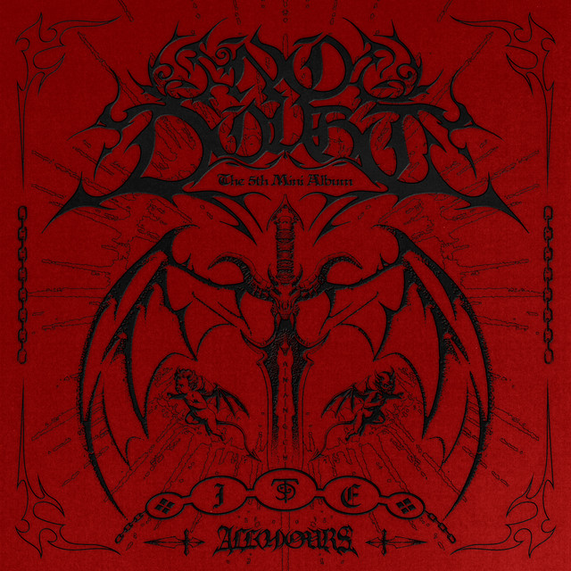

# NO DOUBT

- 아티스트: ALL(H)OURS
- 발매일: 2026-03-16
- 별점: ★★☆ 2.1
- 기록일: 2026-03-20
- repov 인덱스: 496

---

AI작곡프로그램만큼 가치 없는 앨범

1. NO DOUBT 3.0
요즘 세계관 있는 아이돌은 영화음악 같은 트랙을 넣더라. 전체적인 이유는 알겠는데 터치가 전혀 섬세하지 않다.

2. DEAD MAN WALKING 1.0
긴 제목을 후렴에서 필살기처럼 외치는 노래 치고 오글대지 않는 노래를 들어본 적이 없다.

3. Piece of Me 2.5
힙합도 알앤비도 쉽지 않지? 이해한다.

4. 7 o'clock 3.5
내가 스트링을 듣고 심장 안 뛰기는 쉽지 않은 일인데 그걸 해내네. 일단 좋은 노래는 맞다. 앨범과 안 맞아서 문제지.

5. 미쳤으니까 1.0
미안한데 내가 오늘 이걸 들어줄 인내심이 안되는 거 같다.

6. 나의 봄, 나의 빛, 나의 숨 1.5
팬송을 어거지로 만들어 부르지 마라. 이걸 듣고 있어야 하는 팬들은 무슨 죄인가.
