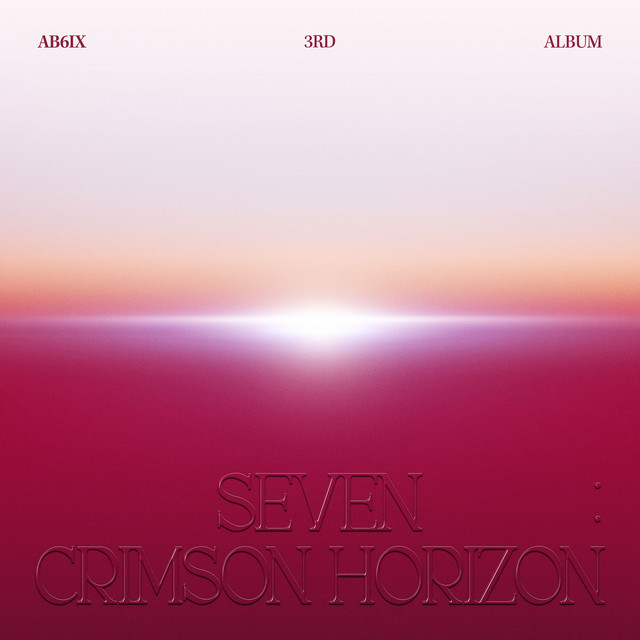

# SEVEN : CRIMSON HORIZON

- 아티스트: AB6IX
- 발매일: 2026-03-16
- 별점: ★★☆ 2.4
- 기록일: 2026-03-20
- repov 인덱스: 497

---

아직 안 갔나?

1. Given 1.5
이렇게까지 혹평을 들을 퀄리티가 아니라고 생각할 수도 있다. 그런데 나는 도저히 이 노래의 존재 이유를 못 찾겠다.

2. BOTTOMS UP 2.0
아프니까 청춘이라는 말에 아직도 불평불만을 하고 있다니, 지금이 대체 몇 년도지?

3. Forever 2.0
이거 작곡가가 누구길래 2010년대에 그대로 냉동된 거 같은 노래를 찍어내는 건가?

4. So Sweet 2.0
심장이 전혀 안 떨린다. 혹시 팬 입장에선 좀 다른가?

5. 어제와 닮은 오늘이 생각보다 따뜻하니까 3.0
전웅의 목소리가 괜찮긴 하다. 전체적으로 듣기도 좋다. 그런데 청춘이라는 단어에서 확 깬다.

6. Holiday 3.0
정국이 훨씬 잘 생각했다.

7. 그런 날 3.5
시티팝과 2000년대 초 발라드를 잘 섞었다. 나라면 이 노래를 김종국에게 줬을 테지만 이대휘도 뭐 그렇게 나쁜 선택은 아니다.

8. 잘 자, 내일 봐 2.5
오히려 작정하고 울리려고 하면 눈물 안 나오는 거 알아?

9. Faded Trail 2.0
이건 뭐 알앤비도 아니고 죽도 밥도 아니고

10. 같이 걷자 3.0
지오디도 20주년에 이런 노래 안 냈는데

11. Endless 2.0
알겠는데 그래서 지금 프듀 찍나?
