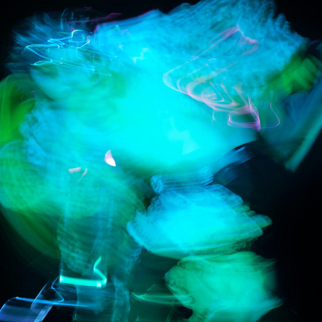

# UNIQUE

- 아티스트: P1Harmony
- 발매일: 2026-03-12
- 별점: ★★★☆ 3.8
- 기록일: 2026-03-19
- repov 인덱스: 500

---

허슬한 건 서용배 쪽인 거 같긴 하지만, 어쨌든 피원하모니도 감당할 여력이 있는 그룹이다.

1. UNIQUE 4.5
친구 많아서 좋겠다

2. Pandemonium 4.0
일렉트로닉은 뻔하지 않고, 브릿지는 적당히 케이팝이다. 라이언 전, 엔믹스 Podium으로 재미 좀 봤나보지?

3. L.O.Y.L. 4.5
중간에 약간 집중력이 흐려지기는 한다. 그래도 충분히 깔롱지다.

4. Wednesday Girl 3.5
그냥 이런 멜로디를 마일리 사일러스 Flower부터 르세라핌 HOT까지 최근에 너무 많이 들었다. Classic is good이지만, not always. 그래도 수요일마저 기다려진다는 가사에는 울림이 있다.

5. Triple 7 4.0
글쎄 운도 실력이라고 당당하게 말하실 수 있을 정도의 실력을 모두가 갖고 계시진 않은데. 7과 chill의 발음을 의도적으로 섞는 아이디어는 뛰어나다.

6. ICE (VVS) 2.5
레이지 트랩을 할 수 있을 정도의 피지컬이 안된다.
