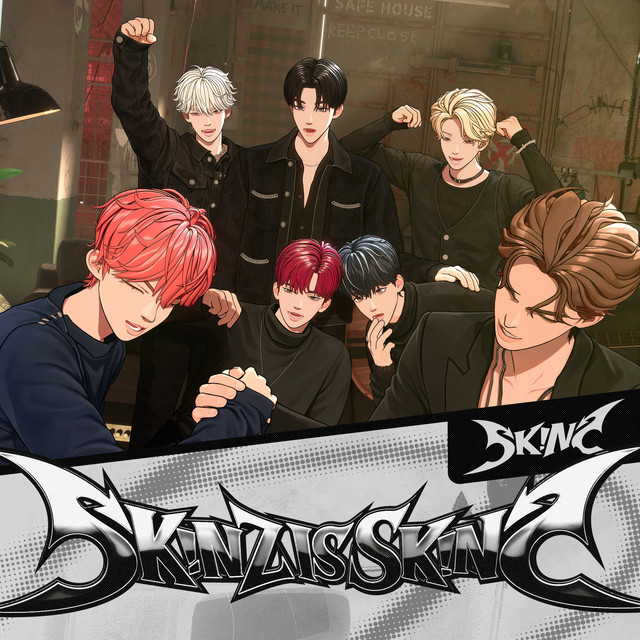

# SKINZ 1st Mini Album [SKINZ IS SKINZ]

- 아티스트: SKINZ (스킨즈)
- 발매일: 2026-03-11
- 별점: ★★☆ 2.5
- 기록일: 2026-03-13
- repov 인덱스: 504

---

음악만은 진짜일 수 있었을 텐데.

1. YOUNG & LOUD 3.0
딱히 흠잡을 곳도, 찬양할 곳도 없다. 적당함에서 한 발 더 나아간 퀄리티를 원한다.

2. Poison Ivy 2.5
2000년대 신화의 냄새가 난다. 새삼 신혜성이 얼마나 좋은 보컬이었는지를 곱씹게 된다. 이런 노래를 들고 왔을 때는 분명 지향하는 섹시함이 있었을 텐데, 이 결과물은 아니다.

3. WHY U MAD 2.5
다크 판타지가 되기엔 현실적이고, 사회고발이 되기엔 순진하다. 전반적으로 이걸 왜 하고 있는지 이해하는 멤버가 많지 않다.

4. Glitch: 99 Degrees 2.5
제목이 99도인 이유는 끓는 점에 도달하지 않는 현상에 대한 변명인가?

5. 25.14 2.0
마지막 발라드 트랙이 있는 걸 보면 아이돌이 확실하긴 하다. 의도는 읽을 수 없다.
