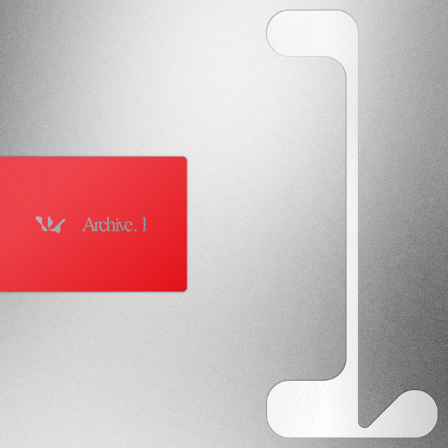

# Archive. 1

- 아티스트: WOODZ
- 발매일: 2026-03-04
- 별점: ★★★★☆ 4.1
- 기록일: 2026-03-06
- repov 인덱스: 519

---

평론가들도 이제는 우즈를 진지하게 생각할 수밖에 없을 걸.

1. 00:30 4.5
어디서 많이 들어본 것 같다 생각하는 순간 아무 것도 예측할 수 없어진다. 파격과 익숙함 사이에서 밸런스를 잘 잡았다. 끝까지 텐션을 가져가지 않은 것이 개인적인 아쉬움으로 남지만, 그래도 이 정도면 훌륭하지.

2. Super Lazy 4.0
아티스트 우즈의 가장 큰 장점은 '척'하지 않는다는 것이다. 역설적으로 가쁜 비트가 제목의 "Lazy"를 뒷받침한다. 게을러지고 싶다는 말은 바쁘게 살고 있다는 반증이지.

3. 하루살이 4.5
이건 혁오가 더 잘했다. 그래도 충분히 체인소맨 OST로 쓸만하지.

4. 화근 5.0
우즈는 평소 이런 노래 부르는 보컬들과 비교했을 때 목소리가 너무 로맨틱하다. 나는 그 특징이 마음에 든다.

5. Human Extinction 3.5
내가 청소년일 때는 넬이 있었다. 요즘 청소년들은 우즈를 갖게 되어 다행이란 생각이 든다. 그 나이에는 자신을 대변할 목소리가 필요하니까.

6. 비행 5.0
서태지가 왜 인기 있었는지 알겠다. 나는 이제 이런 노래를 들을 나이가 아니지만, 그래도 괜찮다. 60대 우리 어머니가 슬램덩크를 못 느낀다고 해서 그 영화가 범상한 작품은 아니지 않은가.

7. Bloodline 3.0
주제의식이 이 노래에서는 잘 들리지 않는다. 본인이 좋아하는 장르라는 것 외에 어떤 인상을 받아야하는지 잘 모르겠다.

8. Downtown 4.0
로맨틱한 목소리의 한계는 오히려 이런 웨스턴 장르에서 드러난다. 본인의 마초적인 취향과 젠더리스한 재능 사이에서 잘 고찰해볼 필요가 있어 보인다.

9. STOP THAT 3.5
후렴은 힘을 주지 않는 편이 좋았다. 그나저나 이런 목소리를 어디서 들어봤나 했더니 지드래곤이 조금씩 들리는군. 힙합 그만둬서 얼마나 다행인지.

10. NA NA NA 3.0
하루살이와 Downtown을 수록한 앨범에 왜 굳이 이 노래까지 넣어놓은 건지? 문제는 의도다, 이 친구야.

11. 몸부림 5.0
이미 인트로부터 마음에 든다. 옥탑방 평상에서 칼춤을 벌이다니, 아주 한국적이며 무속적이다. 현대무용하는 사람들이 이 노래를 좋아할 것이다.

12. BEEP 5.0
아 갑자기 보사노바? 탁월한 선택이다. 삐삐 받아야지.

13. Plastic 4.0
이제는 또 알앤비로 드리프트한다. 악상은 좋은데, 좀 템포를 늦추고 레이백을 즐기자. 그게 알앤비의 매력이지.

14. GLASS 4.0
이상하게 멜라니 마르티네즈로 시작해서, 요즘 이런 노래를 하는 온갖 서양 가수들이 머리를 휙 스쳐지나간다. 감성은 충분히 좋은데, 아무래도 원어민이 아닌지라 다이나믹에서 오는 한계가 있다.

15. CINEMA 5.0
어우 씨네필 남자 진짜 싫어

16. 사모 4.0
이제는 쎄시봉이다. 도저히 이 청년의 속을 가늠할 수조차 없다. 원래 예술가는 나 하나도 너무 많은 것처럼 느껴지기 때문에 예술을 하게 된다.

17. To My January 3.5
이 발상은 차라리 그린데이에 가깝다. 그런데 요즘 작사가들은 한글로 가사 쓰는 법을 완전히 다 잊어버렸나?
