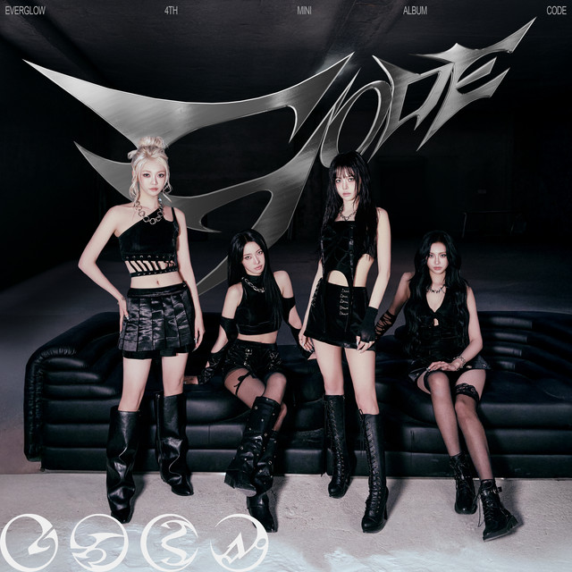

# CODE

- 아티스트: EVERGLOW
- 발매일: 2026-03-03
- 별점: ★★★☆ 3.4
- 기록일: 2026-03-05
- repov 인덱스: 524

---

에버글로우만의 뽕끼를 좀 빼고 싶었던 것 같은데, 이게 좋은 선택이었을까?

1. BREAKOUT 3.5
디렉팅을 너무 느끼하게 했다.

2. FOCUS 3.5
브릿지에서 퓨처베이스의 악몽이 살짝 올라오려고 한다. 중간에 붙인 테크노 리듬은 상당히 좋은데, 역시 최고의 믹스팝은 아무나 만드는 게 아니다.

3. CODE 4.5
케이팝 F1 경주의 승리자는 지금까지 에버글로우다. 이 정도 배짱은 가지고 밟아대야지. 촌스러운 그룹은 역시 촌스러울 때 제일 아름답다니까.

4. Can't Be Broken 2.0
앞에서 열심히 EDM 잘 말아줘놓고 팬송은 갑자기 식상해빠진 밴드사운드로 주겠다고? 정말 서운하다.
