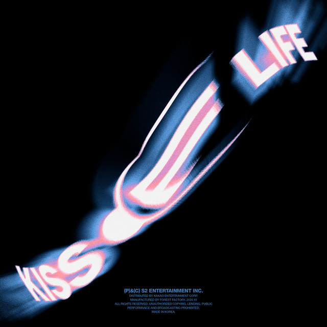

# Lose Yourself

- 아티스트: KISS OF LIFE
- 발매일: 2024-10-15
- 별점: ★★★★☆ 4.6
- 기록일: 2026-03-04
- repov 인덱스: 526

---

나를 포함한 키씨 전원이 대가리를 박아야 하는 명반. 그동안 만점짜리 명반들만 들어서 팬덤의 싸가지가 없어졌다.

1. Get Loud 3.5
부족하다는 생각을 지울 수가 없다. 그 시절에 비해 킥과 베이스가 너무 가벼워서 노래가 전반적으로 붕 떠있다. 레코딩은 깔 부분이 없고 특히 쥴리는 작두 탔지만 멤버들 역량을 세션이 못 받쳐준다. 벌스 멜로디도 직관적이지 않다. 여러모로 데스티니스 차일드 음악의 열화판 같다.

2. R.E.M 4.0
내가 이런 촉촉한 알앤비 장르의 팬은 아니지만 적당히 잘 만들었다. 벨과 쥴리 파트를 듣고 있으면 아리아나 그란데 신보에 도자 캣이 피처링한 것 같기도 하다. 키오프에 영어가 안되는 멤버가 있다는 사실은 문제다.

3. Chemistry 5.0
밸런스를 잘 구현한 음악. 화학에서 제일 중요한 것이다. 지나치지 않는 것.

4. Igloo 5.0
대놓고 쥴리에게 깔아준 판인데 갑자기 벨이 성대로 수류탄을 만들어 던지신다. 난 이 노래에 대중들이 그렇게까지 반응해줄 줄 몰랐다.

5. Too Many Alex 5.0
좀 더 다이나믹하게 디렉팅했으면 타이틀도 충분했을 노래. 이런 구성의 노래는 정확히 콘서트에서 빛을 발한다... 고 예측했고, 내 예측은 맞았다. 알지도 못하는 남자들 이름을 산뜻하게 쥴리 나띠 벨 "밥스카이"로 바꿨을 때의 쾌감이란.

6. Back to Me 5.0
영국 쪽에서 만들 법한 팝펑크 색채가 짙다. 가볍게 듣기 좋은데 개인적인 욕심으로는 마지막 싸비는 한 옥타브 올린 백보컬을 깔았으면 킥이 확실했겠다 싶다. 물론 욕심이고 지금도 충분하다. 이 노래의 히어로는 하늘이다. 막내 뒀다 이런데 써야지.

7. No One But Us 5.0
2016년 EDM 추팔러들 지금 왔니? 이미 키오프는 와 있었단다.
