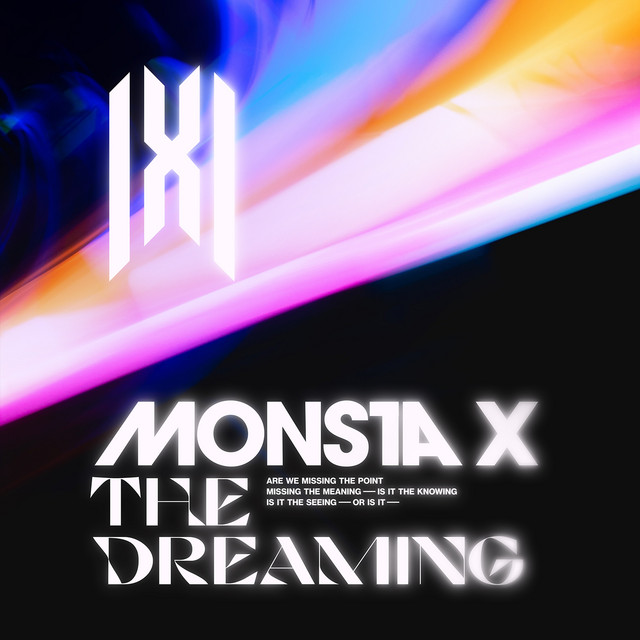

# The Dreaming

- 아티스트: 몬스타엑스
- 발매일: 2021-12-10
- 별점: ★★★☆ 3.7
- 기록일: 2026-03-02
- repov 인덱스: 533

---

내가 알기로 현존하는 케이팝 앨범 중 가장 캠퍼스 드라마에 가깝다. 물론 국적은 미국이다.

1. One Day 3.0
나쁘지 않은 발라드 트랙. 다만 후렴은 좀 무리수라는 생각이 든다. 이 앨범에 수록된 이유는 모르겠다.

2. You Problem 4.0
이 정도로 귀여움 떨어주는 남자 아이돌을 귀하게 여길 줄 알아야 한다. 무작정 귀여울 나이들이 아니라서 더 좋은 거다.

3. Tied to your Body 3.5
기현은 별로 나랑 붙어 있고 싶은 기색이 아니다. 이 산뜻한 양반에게 별로 그딴 거 바라지도 않고.

4. Whispers in the Dark 3.0
후렴이 참 기분 좋은 롤러장 음악이다. 덕분에 이 노래를 80년대 하이틴이라고 우길 수는 있는데, 가는 길이 좀 멀지 않나?

5. Blame Me 4.0
야밤에 술처먹고 전애인에게 전화 걸어본 사람들은 이 노래를 욕해선 안된다. 그게 일종의 낭만이었던 밀레니얼 사람들도 마찬가지다. 일단 나는 욕도 안 할 거고, 셔누와 형원의 전화 정도는 받아줄 의향도 있다. 아이엠은 문자로 할 거고, 기현은 이런 전화 안 할 거다. 부르면서도 속으로 '띠용?'하고 있는게 느껴진다. 이런 산뜻한 양반이 예술을 한다는 게 가끔 좀 웃긴다.

6. Secrets 4.0
내가 알기로 이 노래가 이 앨범의 아이엠 최애곡인데, 이유는 참 명확하다. 섹시하잖아. 새삼 이 노래에 셔누 목소리가 있는게 얼마나 다행인지.

7. About Last Night 4.0
몬스타엑스가 얼마나 술을 잘 마시는지 알고 싶으면 그냥 이거 들으면 된다. 굳이 차쥐뿔이나 몬먹고까지 갈 필요 없다. 눈 앞에 미국 대학생들의 빨간 플라스틱 컵과 뭐가 들었는지 모를 펀치가 둥둥 떠다닌다.

8. Better 3.5
특별히 나쁜 부분 없이 끝까지 유려하게 잘 흘러 간다.

9. Blow Your Mind 3.5
이 앨범에서 유일하게 '케이팝'스러운 노래다. 신화나 동방신기 정도가 했을 것 같은데, 그보다는 가벼운 버전이다.

10. The Dreaming 4.5
난 아직도 이 노래의 반주가 마음에 안 든다. 좀 더 클래식한 피아노를 써줄 수 없었던 걸까? 셔누는 거의 뭐 존 레전드다.
