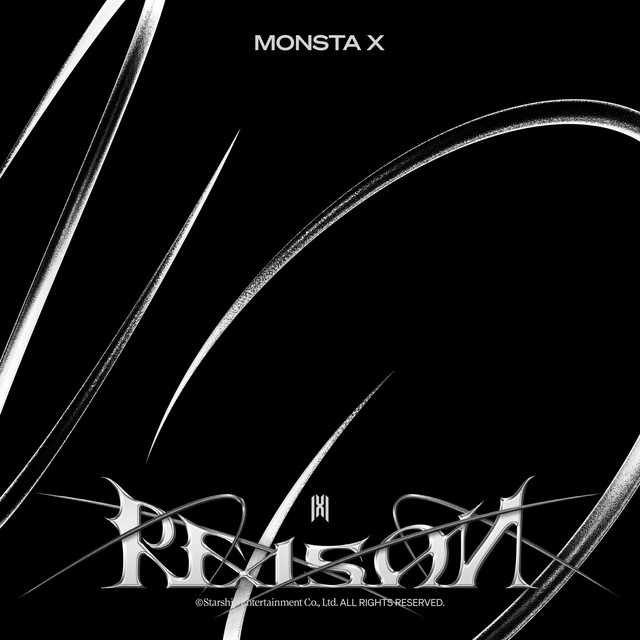

# REASON

- 아티스트: 몬스타엑스
- 발매일: 2023-01-09
- 별점: ★★★☆ 3.6
- 기록일: 2026-03-02
- repov 인덱스: 535

---

그나마 체면치레는 하고 입대해서 다행이다.

1. Beautiful Liar 3.0
몬스타엑스가 해석하는 대중성. 나쁜 노래는 아닌데, 몬스타엑스 노래도 아니다. 솔직히 촌스럽다.

2. Daydream 4.0
다크 팝 전문 몬스타엑스가 낭송하는 잔혹동화. 좋은 노래지만, 나라면 셔누가 제대할 때까지 아껴뒀을 것이다.

3. 춤사위 (Cresendo) 3.5
몬스타엑스의 래퍼는 주헌과 아이엠으로 충분하다는 걸 증명하는 노래다. 딱히 못한다기보다는, 굳이 그럴 이유가 있나 싶다. 물론 셔누는 랩을 못하는 게 맞기 때문에, 이 노래가 셔누 없을 때 나온 건 백번 이해한다.

4. LONE RANGER 4.0
형원의 노래는 그의 세계관을 받아들일 준비가 되어 있는 자에게만 진가가 열리는 경향이 있다. 이 노래는 세계관 설명이 친절해서 다행이다.

5. Deny 4.0
형원이 잘하는 보컬이라고는 입이 찢어져도 말 못한다. 사실이 아니니까. 하지만 좋은 목소리냐고? 당연하다. 그냥 들어 봐라.

6. 괜찮아 (IT'S ALRIGHT) 3.0
말 그대로 괜찮은 노래다. 가장 좋은 모습으로 보내주진 못하더라도, 웃으며 보낼 수는 있게 해준다.
