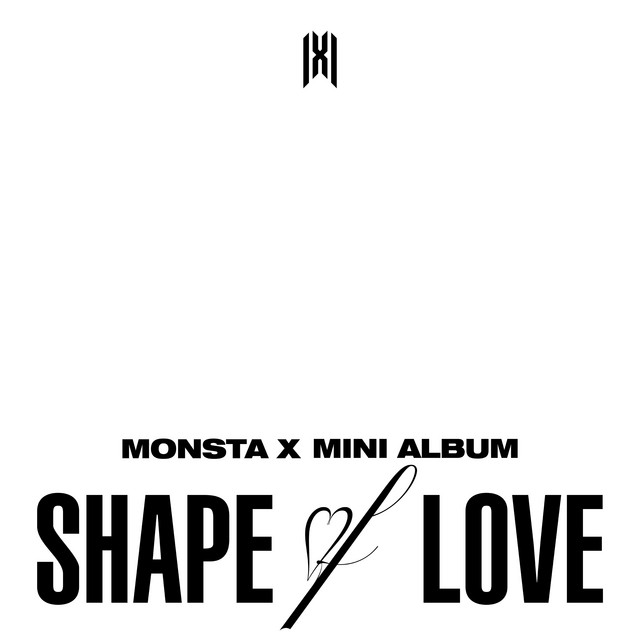

# SHAPE of LOVE

- 아티스트: 몬스타엑스
- 발매일: 2022-04-26
- 별점: ★☆ 1.8
- 기록일: 2026-03-02
- repov 인덱스: 536

---

이거 낼 바에 군대를 가지 그랬나?

1. LOVE 2.0
이 노래를 위해 변을 하나 해주자면, 인스트루먼트는 세기의 걸작이다. 그냥 이런 인스트루먼트를 망칠 정도로 탑라인이 후질 수도 있는 거다.

2. Burning Up 2.5
나는 이게 좋은 노래라고 생각하지도 않고, 타이틀이어야 했다고 생각하는 건 더더욱 아니다. 솔직히 복고에도 정도가 있지 않나. 후렴이 주헌 빨을 받아서 듣는 맛이 있는 정도다. 그런데 그냥 주헌이 맛을 너무 잘 살렸을 뿐. 늘 그랬듯이.

3. Breathe 1.5
이 노래가 잘못 만든 노래라는 뜻은 아니다. 그저 존재 이유를 모르겠다. 앨범을 듣는 입장에선 그게 가장 나쁘다.

4. Wildfire 2.5
셔누와 함께할 수 있을 때까지 기다려야 했다. 형원에겐 진심으로 묻고 싶은데, 기현한테 영어 시키고 싶은가? 가수의 장점에 맞춰 작사를 할 줄 아는 것까지가 프로듀서의 능력이다.

5. 사랑한다 1.0
By My Side는 한 번으로 충분하다. 그 노래를 Stand Up과 섞는 건 더더욱 아니다. 그리고 이상하게도 이 노래는 믹싱이 역대급으로 끔찍하게 되어 있다. 주헌은 데뷔 때부터 믹싱 퀄리티만큼은 잘 지켰는데 말이다. 민혁과 형원은 그렇다 치더라도 기현의 목소리가 자글자글 깨져있는 건 무슨 이유에서인가?

6. AND 1.5
이걸 내고 군대를 가느니 그냥 조용히 가는게 나았을 것이다. 그런데 몬스타엑스는 이걸 내고 군대도 안 갔다.
