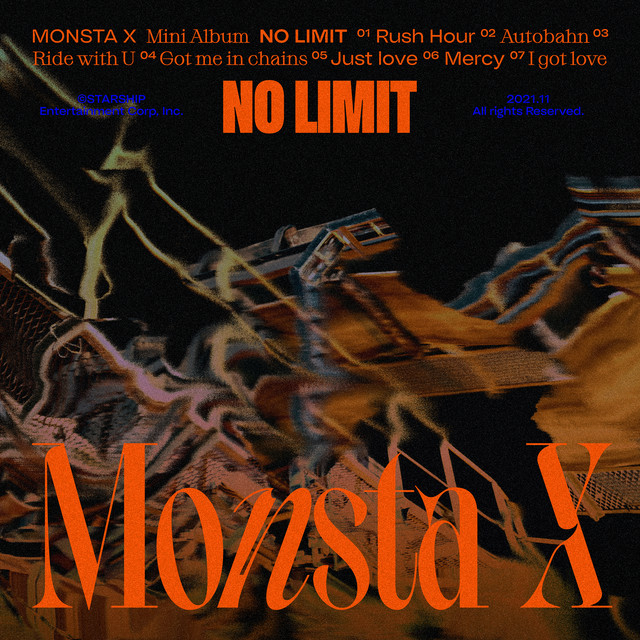

# NO LIMIT

- 아티스트: 몬스타엑스
- 발매일: 2021-11-19
- 별점: ★★★☆ 3.9
- 기록일: 2026-03-02
- repov 인덱스: 537

---

'셔누 없는 몬스타엑스'의 한계를 끝까지 밀어 붙인 앨범.

1. Rush Hour 4.0
이 노래가 세븐틴의 HOT과 거의 비슷한 시기에 나왔는데, 성적이야 HOT 쪽이 훨씬 좋지만 노래의 퀄리티는 이 쪽이 압승이다. 이 말이 와닿지 않는다면, 당신이 사막을 달릴 때 두 노래 중 하나만 틀 수 있다고 가정해보라.

2. Autobahn 5.0
형원은 이 노래가 아우토반을 정확히 형상화했다고 했지만, 나는 아우토반에 가본 적 없어서 모르겠다. 그보다는 건담이 좀 더 생각나는 쪽이다. 물론 아이엠은 둘 다 경험해본 적 없을 것이다. 사실 이 노래를 가장 정확히 묘사한다면, 사이버펑크 터널에 진공으로 빨려들어가는 기분이라 해야할 것이다.

3. Ride with U 4.5
민혁과 형원의 책임감이 느껴지는 노래다. 기현의 런이 환상적이다. 드라이브를 할 때 이런 노래를 틀지 않는 사람과 안전운행은 할 수 있을지 몰라도, 연애는 못한다.

4. Got me in chain 3.5
드라이브는 인류가 말에 탔을 때부터 섹스의 은유였다. 그걸 이해하지 못하는 자는 드라이브송을 부를 자격이 없다. 몬스타엑스는 자격이 차다 못해 넘치는 그룹이다.

5. Just Love 4.0
나는 이 노래의 퀄리티가 너무 좋아서, 이거 내고 다들 군대 갈 줄 알았다.

6. Mercy 3.0
이 노래는 느끼는 사람과 못 느끼는 사람이 극단적으로 갈리는 노래인데, 나는 개인적으로 잘 못 느낀다. INFP친구는 좋아하더라만.

7. I got love 3.0
그냥 이런 노래를 만들고 부르겠다는 발상이 귀엽지 않나?
