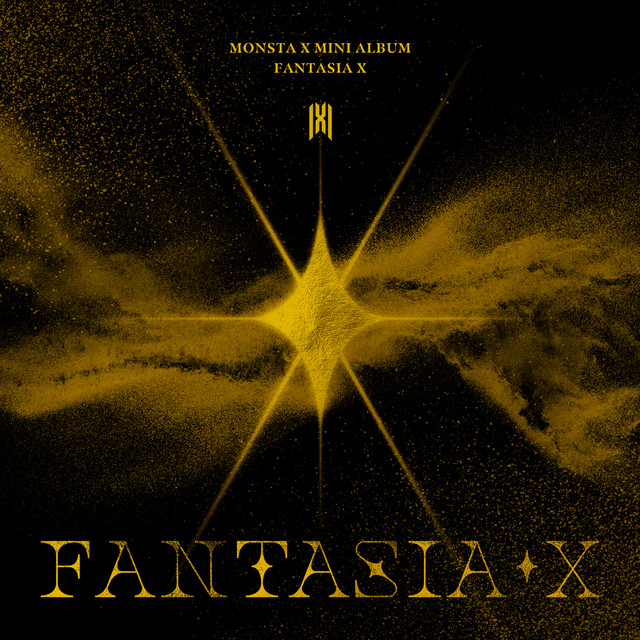

# FANTASIA X

- 아티스트: 몬스타엑스
- 발매일: 2020-05-26
- 별점: ★★☆ 2.8
- 기록일: 2026-03-02
- repov 인덱스: 538

---

퀄리티만 따지면 그냥 없는 셈 치는 편이 낫다.

1. FANTASIA 0.5
공들여 욕하기조차 싫다.

2. FLOW 0.5
머리가 복잡할 때 음악을 만들어야 하는 사람이 있고 병원에 가야하는 사람이 있다. 주헌은 후자다.

3. ZONE 4.5
그래도 정신줄 잡은 사람이 한 명은 있다. 막내가 실세여서 얼마나 다행인지 모른다.

4. Chaotic 3.0
이런 노래를 가만히 듣고 있으면 몬스타엑스가 왜 다크 팝을 잘하는지 알 수 있다. 기본적으로 선한 빛을 지향하는 목소리가 기현을 제외하고 없다. 그 대비가 질리지 않고 들을 수 있는 다크 팝을 완성시키는 것이다.

5. Beautiful Night 4.5
기분 좋은 밤바람이 3분 4초 내내 불어온다. 몬스타엑스가 왜 까먹은 건지 이해가 안되는 명곡 1위다.

6. IT AIN'T OVER 3.5
이런 수록곡이 그나마 디스코그래피의 퀄리티를 단단하게 다지는 역할을 한다.

7. Stand Up 3.0
주헌도 말이 되게 가사를 쓰는 편은 아니다. 사실 이건 형원을 제외한 모든 팀 내 프로듀서의 문제다. 하지만 다시 일어나려고 하는 이들의 파이팅을 누가 감히 폄하할 수 있겠나.
