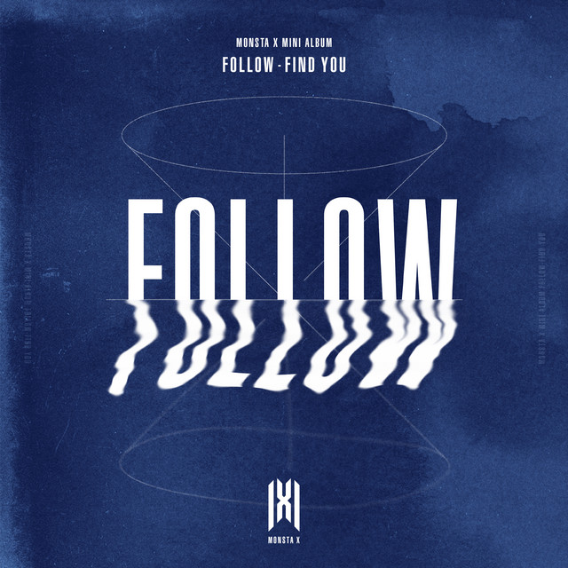

# 'FOLLOW’ : FIND YOU

- 아티스트: 몬스타엑스
- 발매일: 2019-10-28
- 별점: ★★★☆ 3.8
- 기록일: 2026-03-02
- repov 인덱스: 539

---

비운의 명작.

1. find you 5.0
서사가 없었어도 이미 아름다운 노래였다. 셔누의 존재는 천사라는 말 외에 표현할 방법이 없다.

2. Follow 5.0
몬스타엑스를 한바탕 뒤흔든 논란 때문에 이 노래가 충분히 주목받지 못한 것이 케이팝의 비극이다. 스타일링까지 아름다웠으며, 심지어 몬스타엑스치고 뮤비도 걸작으로 나왔다.

3. Monsta Truck 5.0
『The Code』부터 시작된 몬스타엑스의 성숙이 최고점에 도달한 노래다. Caesar & Luoi가 참여한 몬스타엑스 곡을 일렬로 줄 세워놓고 들어 보라. 한 청년이 남자로 성장한 기록을 보는 기분에 눈물이 나올 정도다. 죽을 만큼 세련됐고 그만큼 섹시하다.

4. U R 5.0
다시 한 번 말하지만 아이엠이 트랩은 들고 가면서도 퓨쳐베이스는 때려쳐줘서 얼마나 고마운지 모른다. 덕분에 이렇게 탁월한 알앤비가 나왔다. 이 노래가 아니었다면 기현의 락발라드를 알앤비에 우겨넣을 수 있다는 사실을 누가 알았겠는가.

5. Disaster 3.5
기현의 대단한 점이라면 늘 거기서 더 발전한다는 것이다. 흠잡을 데 없는 영어는 아니지만 듣기에 거슬리지 않을 정도다.

6. Burn it up 2.5
이해한다. 원래 후렴이 제일 작곡하기 어렵다. 그래도 몬스타엑스가 워낙 다크 팝을 잘 해서 다행이다.

7. Mirror 2.5
이 당시 기현은 아직 이런 노래를 할 수 있을 정도의 무게감을 갖지 못했다. 기현에 대한 이해가 U R과 이 노래의 퀄리티 차이를 갈랐다.

8. See You Again 1.5
납득이 되지 않는 구성이다.
