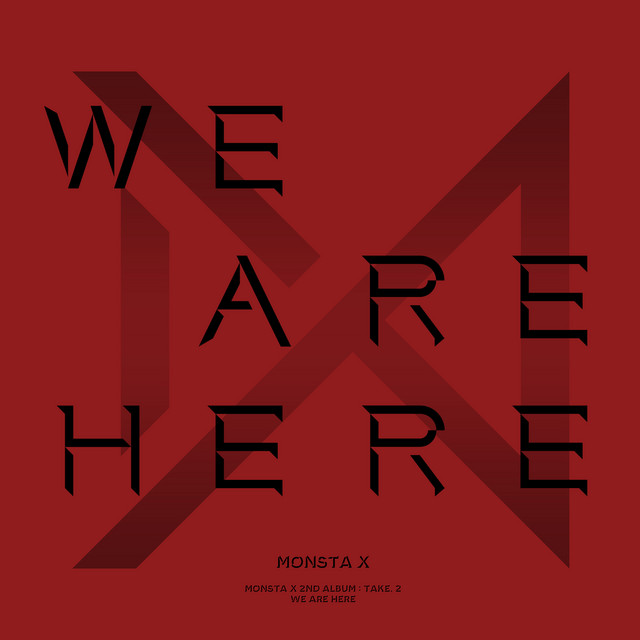

# WE ARE HERE - The 2nd Album Take.2

- 아티스트: 몬스타엑스
- 발매일: 2019-02-18
- 별점: ★★☆ 2.8
- 기록일: 2026-03-02
- repov 인덱스: 540

---

어떤 가능성을 보여주긴 했으나, 셔누라는 환상에 잡아먹혀버린 비운의 콘셉트.

1. INTRO: WE ARE HERE -
몬스타엑스가 이 이후로 세계관 같은 거 안해서 얼마나 다행인지 모른다.

2. Alligator 1.0
말 그대로 딱히 이유가 없는 노래를 가져다가 살려보겠다고 셔누와 스타일리스트들이 고군분투한 노래다. 물론 가장 숨통 터질 만큼 고생한 건 기현이고 모두가 자신의 역할을 100% 이상으로 해냈던 시절이지만, 셔누가 없었다면 이 노래를 할 엄두를 내지 않았을 것이다. 그게 셔누라는 엔터테이너의 비극이다.

3. 악몽 2.5
이 노래가 이후 Thriller 같은 노래의 좋은 발판이 된다. '기현을 이렇게 써야한다'는 고정관념만 없어도 훨씬 좋았을 텐데 말이다.

4. Play It Cool 4.5
쿨하고 섹시하다. 2019년의 몬스타엑스가 반드시 해야하는 노래다. 셔누와 형원은 영어를 하는 편이 낫다. 당신이 만약 셔누가 춤으로 어디까지 할 수 있었던 사람인지 보고 싶다면, 가슴까지 파인 니트와 헐렁한 바지를 입은 채 이 노래에 춤을 추던 셔누의 직캠을 보도록 해라. 나는 그 직캠 장례식에서 틀 거다.

5. No Reason 3.0
말 그대로 이유가 없는 가사다. 그나마 셔누와 민혁이 원호의 노래와 합이 뛰어났다는 것에 가산점을 주겠다.

6. Give Me Dat 2.5
이 당시 스타쉽은 노래를 원호로 열어야 한다는 잘못된 생각을 가지고 있었다. 퀄리티를 위해선 레코딩을 할 때 기현을 아껴선 안된다. 어차피 드라마라마에서 이미 기현 파트를 무대에선 형원과 원호에게 나눠준 적 있잖아? 심지어 이건 콘서트 아니고서야 무대할 예정이 있었을 노래도 아닌데.

7. 난기류 2.0
이 노래를 지지하는 몬베베가 꽤 되는 걸로 알고 있다. 퓨쳐베이스를 좋아하니까 그런 것이겠지. 몬베베가 퓨처베이스 좋아하는게 무슨 죄겠나. 하지만 나는 기현의 영어 발음에 점수를 줄 생각이 요만큼도 없다. "Turbulence" 만큼은 셔누에게 맡겼어야 했다.

8. Rodeo 4.0
이 노래를 들으며 트레드밀 뛰어본 적 있나? 꼭 해보길 추천한다. 죽을 것 같다 싶을 때쯤 틀으면 된다. 그야 이건 로데오라잖아. 뛰어야지.

9. Stealer 1.5
투피엠 이후로 노래에 심박수를 넣어도 되는 그룹이 있다면 그건 몬스타엑스가 맞다. 그렇다고 해서 이 노래가 잘 만든 노래란 뜻은 아니다. 그냥 처음부터 끝까지 이게 뭔가 싶다. 차라리 인피니트가 했으면 이해라도 했겠다.

10. Party Time 4.0
이 노래의 히어로 파트는 주헌이고, 이 노래의 히어로 댓글은 "이민혁 따라라-라라-따라나와"다. 그리고 이 파티의 히어로는 아이엠이 된다. 어차피 계산은 대표님이 할 거니까.
