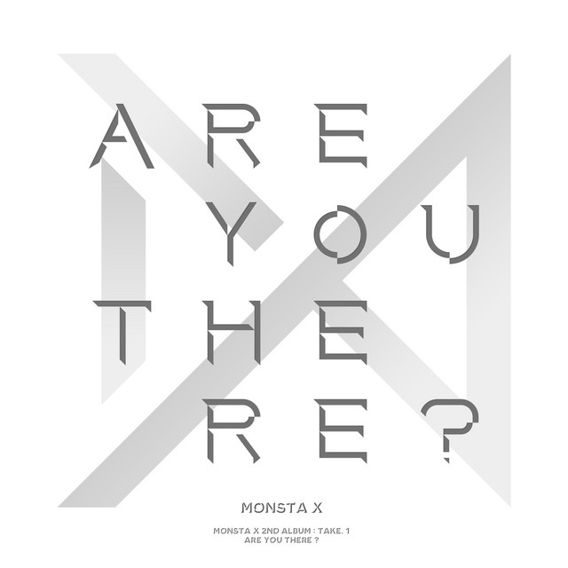

# ARE YOU THERE? - The 2nd Album Take.1

- 아티스트: 몬스타엑스
- 발매일: 2018-10-22
- 별점: ★★★☆ 3.4
- 기록일: 2026-02-28
- repov 인덱스: 541

---

탁월한 시도와 진부한 강박 사이에서 길을 잃은 기획

1. INTRO: ARE YOU THERE? -
몬스타엑스는 목소리가 최고의 악기고 그 중에서도 기현과 주헌이 가장 비싸다는 이야기를 하긴 했지만, 이런 식으로 듣게 될 줄은 몰랐다.

2. Underwater 3.0
기현에게서 아직 발견되지 않은 목소리가 있었다니, 듣지 않았으면 믿지 않았을 것이다. 컨셉에 맞추어 물거품 같이 조절한 톤이 인상적이다. 노래 자체에 특별한 점은 크게 없다. 엘리 굴딩이 살짝 생각난다 정도?

3. Shoot Out 2.0
퓨처 베이스가 썩 매력적이지 않다는 생각엔 변함이 없다. 애당초 몬스타엑스가 아니라면 사람이 이런 노래를 시도할 생각을 할 리가 없다.

4. Heart Attack 4.5
드라마라마라는 역작을 만들어낸 A-DEE와 DREW RYAN SCOTT가 또 다시 일을 쳤다. 이 노래를 완성시키기 위해 기현이 거의 죽을 뻔한 일화를 생각할 때마다 마음이 주체할 수 없이 흐뭇해진다. 실제로 몬스타엑스 노래 중 가장 트랙 구성이 복잡하다. 이 노래를 라이브하지 않는 이유는 까먹어서라기 보다는 그냥 물리적으로 불가능해서일 것이다.

5. 널하다 (I Do Love U) 3.5
정치적인 이유로 다시는 공연할 수 없는 곡 중에 팬송이 포함된다는 사실이 참 웃기고도 슬프다. 멤버들의 말버릇과 셔누의 장기가 그대로 녹아있는 곡이라 아깝다.

6. 어디서 뭐해 (MOHAE) 1.5
이 노래의 트랙 설명이 "퓨쳐베이스를 바탕으로 강렬한 신스 사운드와 상반되는 일렉트릭 피아노와 여러 사운드가 어우러진 곡"이다. 내가 좋아할 리가 없고, 장르적 특성을 감안하더라도 잘 만든 노래가 아니다. 아이엠이 이 노래 이후 퓨처베이스에서 아예 손을 떼서 얼마나 다행인지 모른다.

7. Oh My! 4.5
마그네틱보다 이 노래가 먼저였군? 몬스타엑스가 썩은 퓨쳐베이스 같은 거 집어치우고 라틴에 집중했더라면 지금쯤 1군이 되었을텐데 말이다. 뭐 국내에선 어려워도 최소한 외화는 지금보다 훨씬 벌었겠지.

8. Myself 3.0
이 노래가 벌스는 참 신선하고 좋다. 그런데 브릿지부터 후렴은 진부해서 미칠 지경이다. 몬스타엑스라면 노래에 이런 부분이 있어야 한다는 강박마저 느껴지는데, 별로 옳은 확신은 아니다.

9. By My Side 5.0
몬베베 사이에서 "팬송에 바이 마이 사이드만 있는 게 아니다."라는 말이 나오는 걸 알고 있다. 참 배부른 양반들이다. 이런 팬송을 가지고 있는게 얼마나 큰 행운인지 모르고. 2절의 셔누는 천금을 주어도 바꾸지 않겠다.

10. SPOTLIGHT (Korean Ver.) 4.0
몬스타엑스의 특징 중 하나라고 한다면, 오타쿠 비중이 적어서 일본어를 지독하게 못한다는 거다. 그나마 민혁과 아이엠 정도가 흉내라도 낼 줄 알던데. 그래서 가사를 한국어로만 바꿔도 퀄리티가 올라간다. 그런데 이 노래 모른다고 서운해할 일은 아니다. 그야 가사를 원호가 썼는데 이걸 해줄 거라고 생각한 사람이 어딨겠어.
