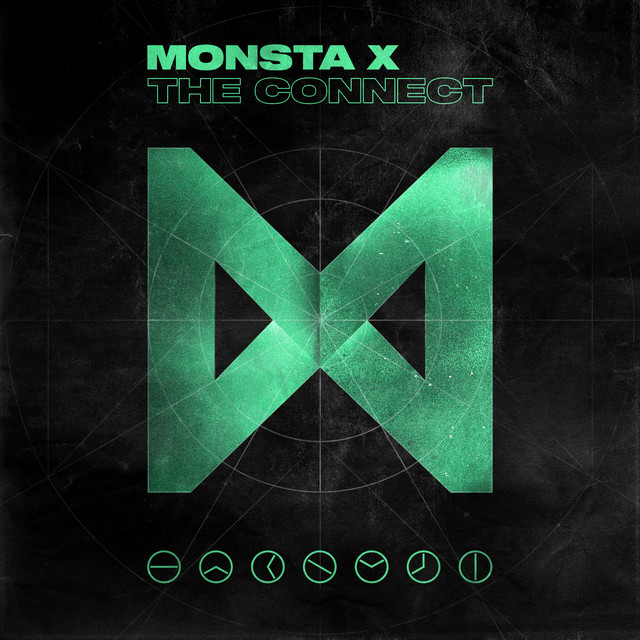

# THE CONNECT : DEJAVU

- 아티스트: 몬스타엑스
- 발매일: 2018-03-26
- 별점: ★★★☆ 3.3
- 기록일: 2026-02-28
- repov 인덱스: 543

---

앨범의 만듦새에 성의가 없다. 도전은 꼭 모든 걸 다 해보라는 뜻이 아닌데.

1. Jealousy 4.5
기현의 애드립과 아이엠의 목소리로 시작한다. 살살하지 않겠다는 거지. 기현이 이거 하느라 죽을 만큼 힘들었을 걸 생각하면 즐거워서 웃음이 다 나온다. 뮤직비디오와 춤만 아니었어도 만점으로 올렸을 텐데 말이다.

2. Destroyer 2.0
락은 이런 데 쓰라고 있는 장르가 아니고, 몬스타엑스도 이런 거 하라고 있는 목소리들이 아니다.

3. 폭우 5.0
장소와 장비를 심하게 타는 노래가 있다는 걸 이해해야 한다.  이 노래를 이어폰으로 앉아서 들으면, 발을 지지직 끌고 들어오는 808 드럼이 부대낄 수 있다. 그러니 일단 일어들 나시고, 콘서트장에 갈 수 없다면 스피커로 틀어라. 웬만하면 랩 파트를 다 외워오길 권장한다.

4. 미쳤으니까 2.0
별들의전쟁 멱살을 잡고 싶다. 이 노래에 국물도 안 나오는 사골 트랩은 진짜 아니다. 차라리 어쿠스틱하게 가지.

5. Lost in the Dream 4.5
기현의 브릿지를 위해 달려가는 노래가 맞다. 그게 나쁜가? 최종장을 온전히 느끼기 위해서 앞의 악장을 견뎌야 하는 클래식이라고 생각해라. 심지어 견딘다는 표현을 쓸 정도로 나쁘지도 않고. 특히 형원의 목소리가 이런 다크한 곡에서 한 몫을 톡톡히 한다. 그런데 막상 히어로 파트의 믹싱이 좀 아쉽다. 그 부분은 취향의 영역으로 넘기겠다.

6. If Only 2.5
음절을 맞추기 위해 꾸역꾸역 넣은 가사를 좋아하지 않는다. 그런 사소한 무성의가 곡의 퀄리티를 해치는 결정적 요소가 되곤 한다.

7. Special 2.5
주헌은 셔누에게 랩을 시키겠다는 기이한 욕망을 대체 어쩌다 가지게 된 걸까? 몬스타엑스의 공성추는 기현이라는 사실을 잊지 마라.
