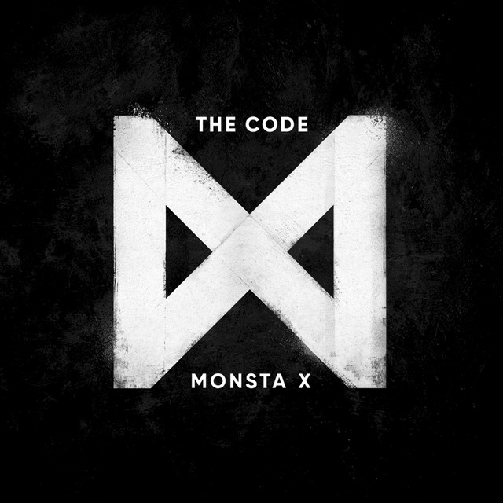

# THE CODE

- 아티스트: 몬스타엑스
- 발매일: 2017-11-07
- 별점: ★★★☆ 3.9
- 기록일: 2026-02-28
- repov 인덱스: 544

---

몬스타엑스 2기의 세련된 시작이자, 환상처럼 빛나고 흩어진 명반.

1. DRAMARAMA 5.0
내가 몬스타엑스를 눈여겨보기 시작한 이유다. 이 노래는 모든 요소를 전부 해체해서 하나하나씩 찬사를 보낼 수 있다. 그 정도로 명곡이다. 말 그대로 적당히 좋아할 수가 없으며, 잊을 수가 없는 아름다운 충격이다.

2. Now or Never 3.0
1기의 망령 같은 노래다. 아무래도 아름다워를 작곡한 별들의 전쟁이 참여한 노래니까 그렇겠지만. 그래도 꽤 정제되고 세련된 사운드를 보여준다.

3. In Time 5.0
나는 한 그룹의 실력을 보고 싶을 때 발라드 트랙을 찾아 듣는 편이다. 왜냐하면 발라드는 상대적으로 프로듀싱에 숨기 어려운 장르이기 때문에. 그런데 이런 노래가 자체 제작한 곡이기까지 하다면? 더 이상 의심할 필요조차 없다. 이 시기를 기점으로 기현은 어떤 경지에 올랐다.

4. From Zero 5.0
나는 2017년이 트로피칼 하우스의 시대였던 것이 너무 좋다. 이 노래는 그 시대를 상징하는 명작 중 하나다. 원호는 셔누의 목소리를 가장 아름다운 방식으로 쓰는 방법을 알았다.

5. X 4.0
Now or Never가 1기의 망령이라면, 이 노래는 1기의 유산이다. 이 노래를 들을 때마다, 사람이 어떤 상황에서든 열심히 해야 하는 이유를 깨닫는다. 개인적으로 형원을 가장 칭찬하고 싶은 트랙.

6. 열대야 4.0
이제 막 20대 중반에 접어든 청춘을 상징하는 노래다. 아직 혈기왕성하지만 막 성인이 되었을 때보다는 정제되었고, 조금 신중해졌지만 아직은 취해있고 싶다. 이 때는 무엇이든 가능하다. 죽을 만큼 유치해지는 것도, 치기 어린 섹시함도.

7. Deja Vu 1.5
이 노래가 있어야 할 앨범은 The Code가 맞다. 그런데 이 앨범에 이 노래가 있어야 하냐고? 글쎄.
