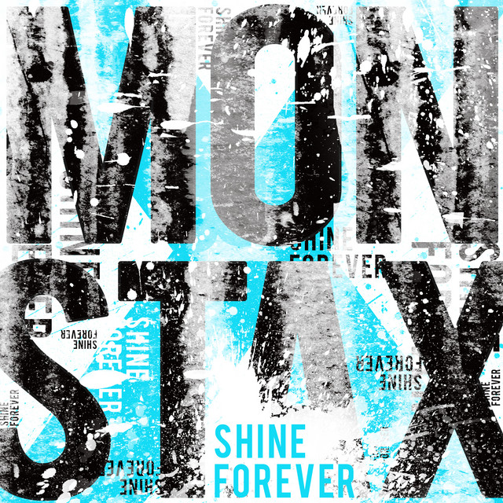

# SHINE FOREVER

- 아티스트: 몬스타엑스
- 발매일: 2017-06-19
- 별점: ★★★ 3.0
- 기록일: 2026-02-28
- repov 인덱스: 545

---

『Beautiful』이 포장할 가치가 있는 앨범은 아니지만, 그래도 나름 좋은 포장지 썼다.

1. SHINE FOREVER 3.5
일단 퓨처 베이스 장르의 매력 자체를 잘 모르겠다. 그런데 왜 몬스타엑스 좋아하냐고? 그래서 2021년 되어서야 입덕한 거 아닌가. 어쨌든, 이건 개중에 그나마 잘 만든 노래다. 왜냐하면 기현을 그냥 뭐 있는 대로 갈아 썼거든. 그러니까 원재료의 맛을 높이 쳐주는 거다.

2. GRAVITY 5.0
사람들은 절대 빼앗을 수 없는 몬스타엑스만의 노래로 러브 킬라를 꼽는 경향이 있다. 무슨 말인지는 알겠는데, 나는 개인적으로 이 노래야말로 진짜 몬스타엑스만 할 수 있는 노래라고 생각하다. 셔누가 세상에 둘씩 있는지 알아?

이외 평점은 THE CLAN pt.2.5 [BEAUTIFUL]과 상동.
