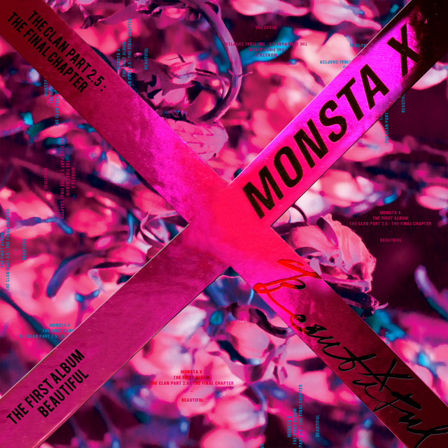

# THE CLAN pt.2.5 [BEAUTIFUL]

- 아티스트: 몬스타엑스
- 발매일: 2017-03-21
- 별점: ★★☆ 2.7
- 기록일: 2026-02-27
- repov 인덱스: 547

---

장황할 이유를 찾아볼 수 없다.

1. READY OR NOT 1.5
내가 궁금한 건, 이 노래를 만들 때 이걸 빠르게 틀어볼 생각을 아무도 안했냐는 거다.

2. 아름다워 (BEAUTIFUL) 5.0
이 노래를 살려내기 위해 참 많은 분들이 노력해주셨지만, 영광은 아이엠에게 바칩니다. 당연하지만 놀리는 겁니다.

3. 넘사벽 (INCOMPARABLE) 2.5
제목과 가사가 이래야만 했던 이유를 설명해라. 이거 진짜 좋은 알앤비일 수 있었거든?

4. 니가 필요해 (Need U) 3.0
딱 이 정도가 몬스타엑스가 구가해야하는 저점이다.

5. OI 2.0
원래 첫 술은 배부르려고 뜨는 게 아니다. 그 사실이 원호에게 위안이 되길 바란다. 기현의 입에서 후렴의 형태로 꼰대 소리를 뽑아냈다는 역사적 의의는 인정해주겠다.

6. Miss You 2.5
기현에게 후진 멜로디 좀 그만 소생시키라고 빌고 싶은 심정이다.

7. CALM DOWN 0.5
HERO를 3탄이나 들어야 할만큼 몬베베가 큰 잘못을 저질렀다고 생각하지 않는다.

8. 너만 생각해 (ALL I DO) 1.5
딱히 나쁜 점을 찾기 어려운데 이만큼 와닿지 않기도 쉽지 않다. 그런데 사실 그게 제일 문제다. 예술은 어떤 형태로든 심장을 울려야 하니까.

9. 5:14 (LAST PAGE) 4.0
특별한 점이 없으면 팬송은 좋은 점수 주기 힘들다고 했지? 기현의 목소리가 바로 그 특별한 점이다.

10. 넌 어때 (I'LL BE THERE) 4.5
나도 좋다. 어쨌든 원호는 팬들을 사랑했고, 나는 그라는 사람에 대한 호불호를 떠나 예술 앞에서 사람의 진심은 인정받아야한다고 생각한다. 그가 아티스트라는 사실도.
