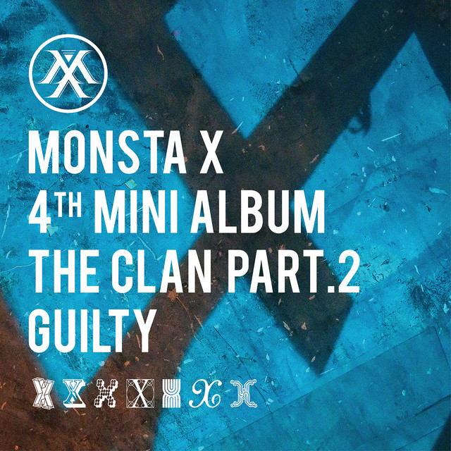

# THE CLAN pt.2 <GUILTY>

- 아티스트: 몬스타엑스
- 발매일: 2016-10-04
- 별점: ★★★☆ 3.7
- 기록일: 2026-02-27
- repov 인덱스: 549

---

몬스타엑스 디스코그래피의 흐름으로 봤을 때, 이 앨범은 퀄리티의 방점이 주헌에서 기현으로 넘어온 기념비적인 작품이다. 주헌은 영원히 몬스타엑스의 음악적 정체성이지만, 그룹으로 우뚝 서기 위해선 기현을 올바로 써야한다.

1. FIGHTER 5.0
두 주먹 불끈 쥐고 덤빈다. 이런 노래는 진심으로 상대해줘야 예의다. 기현의 모든 파트를 케이팝 명예의 전당에 올려도 된다.

2. BE QUIET 3.0
그러니까 펀치사운드도 없는데 왜 HERO가 후속곡까지 나와야 했는지 설명을 해달라.

3. BLIND 2.5
기리보이씨 기현이 유일하게 못하는 장르가 알앤비인 건 알고 이런 노래 시킨 겁니까?

4. QUEEN 2.5
기현의 "모두 경배 네 세계를 뚫고 내게 와"를 위해 존재하는 노래다. 그걸 제외하면 1점도 아까운데 하필이면 그 파트가 있네. 그러게 기현이 불러서 좋다고 좋은 노래가 아니라니까?

5. 하얀소녀 4.0
솔직하게 말하겠다. 이 노래의 문법은 완전히 CCM이다. 그러니까 하얀소녀는 사실상 성모마리아인데, 문제는 이걸 자각하고 부르는 사람이 한 명도 없다. 아이러니하게도 그래서 좋은 노래다.

6. ROLLER COASTER 5.0
몬스타엑스의 강점은 캐릭터 해석이 잘 되어 있다는 거다. "꿈에서만 보던 이상형"은 형원이 부르는 게 맞지, 아무래도.
