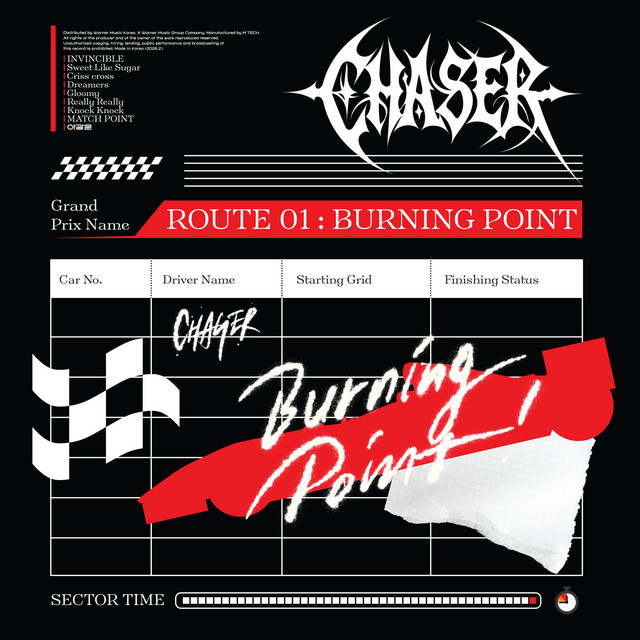

# ROUTE 01 : BURNING POINT

- 아티스트: CHASER
- 발매일: 2026-02-25
- 별점: ★★★☆ 3.1
- 기록일: 2026-02-27
- repov 인덱스: 550

---

요즘 F1이 유행이긴 하구나. 그런데 다들 면허는 있나?

1. INVINCIBLE 3.0
노래가 가진 포텐셜은 매우 좋다. 세븐틴의 손오공이 조금 떠오르긴 해도 악상이 유치하지 않다. 문제는 좋은 프로듀서를 얻지 못했다. 이것보다 더 다이나믹을 줘야한다.

2. Sweet Like Sugar 3.0
대중에 귀에 노래를 갖다 붙이려면 이 정도로는 텐션이 있어야한다. 그런데 목을 너무 아낀다. 그대들은 보컬 트레이닝을 받는 연습생이 아니라 가수다. 좀 더 맛을 살려보도록 해라.

3. Criss Cross 3.0
SM이 시작됐을 때부터 한국 가요계에 자리 잡은 미신 중 하나인데, 노래를 못하면 랩을 시키면 된다고 생각한다. 사실은 노래를 잘해야 랩도 잘한다. 모든 음절을 내뱉을 때 껌을 짝짝 씹는다고 생각해라. 여기 보컬이 그나마 가성을 쓸 줄 안다.

4. Dreamers 3.0
이게 애니메이션 오프닝이라면 꽤 좋았을 거 같다. 그런데 이렇게 파이팅 없이 부르지는 말지? 사람이 노래에서 감정을 전달하지 못한다면 차라리 보컬로이드를 쓰겠다.

5. Gloomy 2.5
갓 데뷔하지 않았나? 그런데 언제 봤다고 이러시는지. 3년은 이르니까 좀 참아라.

6. Really Really 4.0
다이나믹도 좋고 설레는 감정도 잘 전달이 된다. 좀 더 드라이브를 걸면 누구도 반박하기 어려운 명곡이 될 수 있다. 그런데 앨범 컨셉과 미스매치다. 내가 듣기로는 이쪽을 더 잘 이해하는 거 같은데, 왜 청춘 컨셉으로 가지 않았나? 청량돌의 TO가 포화 상태로 보이겠지만, 실력과 진심은 언제든 통하게 되어 있다.

7. Knock Knock 4.0
원래 청량돌로 데뷔시키려고 했는데 F1 역병에 탑승하려고 막판에 타이틀을 바꿨나 싶을 정도다. 그런데 이럴 거면 소속사가 비전을 가지고 앨범을 두 개로 나눴어야 한다. 결국은 전략의 부재다. 남들 하는 거 따라하려 하다간 이도 저도 안된다. 잘하는 건 잠깐 요구 안해줄테니 하고 싶은 말부터 제대로 정하고 와라.

8. MATCH POINT 3.0
미안하다. 내가 어제 몬스타엑스 노래를 들었다. 이 정도 피지컬로는 택도 없다. 그러니까 일단 다들 면허부터 따고 오면 안될까? 메인보컬이 잘하긴 하는데 그걸로 충분하기 어렵다.

9. 야광운 2.5
아무리 생각해도 컨셉 두 개가 섞인 앨범이다. 달린다고 다 똑같은 풍경인 줄 아나?
